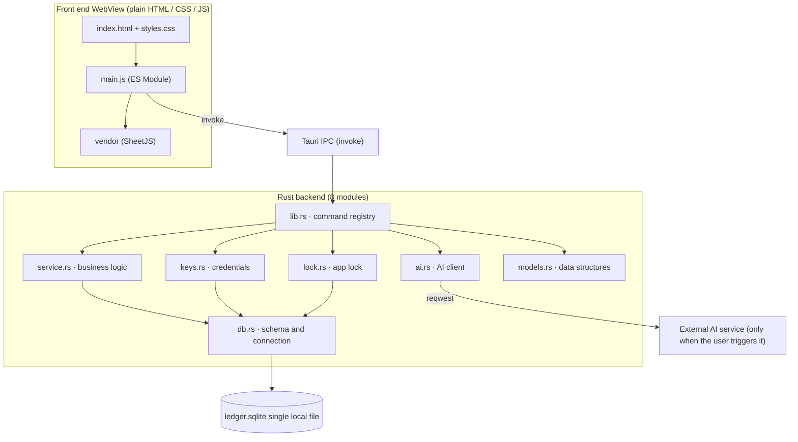

# Ledger Architecture

> **Language**: [简体中文](./ARCHITECTURE.md) ｜ **Baseline**: v1.4.0 (commit `3199811`) ｜ **Last verified**: 2026-10

**One line**: Ledger is an offline-first personal expense tracker — a Tauri v2 + Rust + SQLite single-machine core with a front end that has no framework, no bundler and no build step.

| Item | Notes |
|---|---|
| Audience | GitHub visitors reading the code, developers taking over or extending it, users verifying implementation details |
| Relationship to README | [README.md](./README.md) answers "what is this / how do I use it / what features exist"; this document answers "how the system is put together / why the key decisions were made that way / where the capability boundary sits". Feature lists and installation steps are not repeated here |
| Data source | Every number below was measured from the v1.4.0 source. Where README values have gone stale (line counts, "0 npm dependencies"), this document is authoritative — see [§8 Key design decisions](#8-key-design-decisions-and-trade-offs) and [§11 Build--test--release](#11-build--test--release) |

---

## 1. System overview



### 1.1 Layer responsibilities

| Layer | Contents | Responsibility |
|---|---|---|
| Presentation | `src/index.html` + `src/styles.css` + `src/main.js` | All UI and interaction, statistics computation, export formatting; holds no persistence logic |
| Transport | Tauri IPC | Front end `invoke(command, args)` → Rust `#[tauri::command]`; single window, no custom protocol |
| Business | the 36 commands registered in `lib.rs` plus `service.rs` / `keys.rs` / `lock.rs` / `ai.rs` | Argument validation, amount conversion, transactions, credential management, AI calls |
| Storage | `db.rs` + `rusqlite` | Schema creation, seed data, single-file SQLite access |
| External | `reqwest` inside `ai.rs` | Only appears when the user clicks "Generate analysis"; strictly one-directional (app → provider) |

### 1.2 Runtime constraints

| Constraint | Value | Evidence |
|---|---|---|
| Network | **Zero outbound by default**; no external request happens unless "Generate analysis" is clicked | The CSP in `tauri.conf.json` is `connect-src 'self' ipc: http://ipc.localhost`, so the WebView cannot make arbitrary outbound requests; every AI request is issued by `reqwest` on the Rust side (`ai.rs`) |
| Data location | Single file `ledger.sqlite` in the OS-assigned app data directory, **never inside the repository** | `db_path()` in `lib.rs` (`app.path().app_data_dir()`); `.gitignore` excludes `*.sqlite` |
| Front end | No framework, no bundler, no build step; `index.html` loads `main.js` directly via `type="module"` (`withGlobalTauri: true`) | `package.json` (no bundler in devDependencies), `frontendDist: "../src"` in `tauri.conf.json` |
| Target platforms | Android 7.0+ (API 24+), Windows 10+ | README target-platform table; `capabilities/default.json` scopes permission to the main window only |
| Size budget | APK < 50 MB, Windows installer < 10 MB (**targets, not measurements**) | README target-platform table |
| Performance target | Cold start < 2s, single entry ≤ 3s (**targets, not measurements**) | README target-platform table |

> Note: the last two rows are project **targets**, not measured results. This document makes no conclusive claim about unmeasured performance numbers.

### 1.3 Product positioning (distilled from the early charter / PRD / user stories)

- **Target users**: lightweight personal users who want to log an entry in 3 seconds, would rather not upload their ledger to the cloud, and need neither multiple ledgers nor collaboration.
- **Core promises**: logging an entry is fast enough; data stays on this machine only; one codebase gives a consistent experience on PC and Android.
- **Non-goals that still hold**: multi-user / accounts / cloud sync / multiple ledgers / multiple currencies (see [§9](#9-known-boundaries-and-non-goals)).
- **Two divergences from the early documents**: (1) the early charter listed "visually and interactively close to a native iOS app" as an experience goal, but the current theme is a warm neutral paper feel with dark indigo accents ([§13](#13-ui-design-language)) — that claim is void; (2) the PRD's P1 speech-reading / translation features were never built and are not on the roadmap.

---

## 2. Module structure

### 2.1 Front end (3 source files + 1 vendor directory)

| File | Lines | Responsibility |
|---|---:|---|
| `src/index.html` | 699 | All page structure: home / stats / category detail / settings, plus the entry sheet, calendar, four action sheets, lock overlay and batch-action bar |
| `src/main.js` | 3810 | All logic (one ES module): state, rendering, statistics, import/export, AI panel, lock screen, theme |
| `src/styles.css` | 2353 | All styling: theme variables, components, motion |
| `src/vendor/xlsx.full.min.js` | 929.6 KB | SheetJS 0.20.3, shipped in-repo (offline + CVE avoidance), lazily loaded only on the Excel import path |
| `src/vendor/README.md` | — | Origin, hash and upgrade steps for the vendored file |

Sections inside `main.js` (following the section comments in the file):

| Section | Main output |
|---|---|
| Categories & rules | `CATEGORIES` / `CAT_MAP` loading, custom keyword auto-categorisation rules (`cat_rules`) |
| Home page | Month list grouped by day, search, month-over-month delta, multi-select batch actions, swipe-to-delete, long-press menu, quick-template chips |
| Entry sheet | Numeric keypad, amount input, category grid, date calendar, save-as-template, re-entry guard |
| Stats page | Period switching (year/month/week/day), hand-written SVG donut, category list, 6-month trend, expense/income views |
| Category detail | Monthly detail and statistics for one category |
| AI panel | Monthly analysis generation, cache read/write, privacy consent, key configuration entry |
| Settings | Budget, theme, app lock, category management, export/import/clear |
| Lock screen | PIN entry, unlock, set/disable flows |
| Boot | `boot()`: theme → lock → categories → rules → transactions → monthly budget |

### 2.2 Backend (8 modules, 2595 lines total)

| Module | Lines | Responsibility | Depends on |
|---|---:|---|---|
| `main.rs` | 5 | Process entry point, calls `ledger_lib::run()` | `lib` |
| `lib.rs` | 512 | Wiring layer: manages state, registers 36 commands, implements export/import, startup migration | all business modules |
| `db.rs` | 98 | Opens the connection, idempotent schema creation, seed categories, first-run default templates | `models` (implicitly), `rusqlite` |
| `models.rs` | 35 | Three data structures: `Transaction` / `Template` / `Category` | `serde` |
| `service.rs` | 864 | Amount and date parsing/validation, id generation, CRUD, category validation and delete protection, budget, settings access | `models`, `chrono`, `rusqlite` |
| `keys.rs` | 301 | AI config read/write, three-tier key storage, masked echo, legacy key migration | `service`, `ai`, `keyring` |
| `lock.rs` | 101 | App lock: PIN format validation, Argon2id hashing, verification, disabling | `service`, `argon2` |
| `ai.rs` | 679 | OpenAI-style HTTP client: capability-profile degradation, error mapping, tolerant output parsing, TLS setup | `reqwest`, `rustls`, `serde_json` |

### 2.3 Dependency direction

```
main.rs
  └─ lib.rs  (wiring layer; the only place that holds app.manage state)
       ├─ service.rs ─┐
       ├─ keys.rs ────┼─> db.rs connection (injected by lib.rs)
       ├─ lock.rs ────┘        └─> models.rs
       └─ ai.rs  (never touches the database; pure network + parsing)
```

Rule: business functions always take a `&Connection` supplied by the caller inside the lock — **no module holds a connection or spawns threads itself**; `ai.rs` is completely unaware of the database, which is exactly why it can be called across an `await`.

---

## 3. Command contract (36 commands)

Source: the `invoke_handler` list in `lib.rs` (`lib.rs#L521-L557`). The 36 rows below close exactly against it — nothing extra, nothing missing. Every failure path returns `Result<_, String>`, where the `String` is a user-displayable Chinese message.

**Groups (7, 36 total)**: transactions 8 · budgets 2 · templates 4 · categories 6 · settings + lock 7 · ai 7 · data 2.

### 3.1 transactions (8)

| Command | Arguments | Returns | Notes |
|---|---|---|---|
| `list_all` | — | `Transaction[]` | Full list ordered by `date DESC, created_at DESC` |
| `add_tx` | `tx_type`, `amount`, `category`, `note`, `date` | `Transaction` | Amount string → cents; validates that the category exists with a matching type and the note is ≤ 30 chars |
| `update_amount` | `id`, `amount` | `Transaction` | Amount only; re-runs amount validation |
| `update_date` | `id`, `date` | `Transaction` | Date window rules in §5.1; an unchanged date is always allowed |
| `update_note` | `id`, `note` | `Transaction` | Note only; runs the same `normalize_note` as `add_tx` (trimmed, ≤ 30 chars) |
| `delete_tx` | `id` | `bool` | `true` when a row was hit |
| `clear_all_tx` | — | `usize` | Empties `transactions`, returns the deleted count (does **not** touch categories/budgets/templates/settings) |
| `update_category_batch` | `ids: string[]`, `category` | `usize` | Batch re-categorisation; the target must match the direction of **every** selected record |

### 3.2 budgets (2)

| Command | Arguments | Returns | Notes |
|---|---|---|---|
| `get_budget` | `month` (`YYYY-MM`) | `Option<f64>` | Returns `null` when unset; the front end calls it with `viewMonth`, so it re-reads on every month switch |
| `set_budget` | `month`, `amount: Option<f64>` | `()` | Passing `null` deletes that month's entry |

### 3.3 templates (4, i.e. quick templates)

| Command | Arguments | Returns | Notes |
|---|---|---|---|
| `list_templates` | — | `Template[]` | Quick-template list |
| `add_template` | `tx_type`, `amount`, `category`, `note` | `Template` | Same shape as a transaction minus the date |
| `update_template` | `id`, `tx_type`, `amount`, `category`, `note` | `Template` | — |
| `delete_template` | `id` | `bool` | — |

### 3.4 categories (6)

| Command | Arguments | Returns | Notes |
|---|---|---|---|
| `list_categories` | — | `Category[]` | Ordered by `sort`; fallback handling for missing categories lives in `service.rs` |
| `add_category` | `cat_type`, `name`, `icon`, `color` | `Category` | Names must be unique within a type |
| `update_category` | `id`, `name`, `icon`, `color` | `Category` | **Type is immutable** (locked in the UI, preventing existing records from being reclassified) |
| `category_usage` | `id` | `usize` | How many transactions reference this category (used for the delete prompt) |
| `delete_category` | `id`, `fallback: Option<string>` | `usize` | The fallback category itself cannot be deleted; `fallback` must exist and share the type; returns the number of moved records |
| `reorder_categories` | `ids: string[]` | `()` | Rewrites `sort` in the given order (batched inside a transaction) |

### 3.5 settings + lock (7)

| Command | Arguments | Returns | Notes |
|---|---|---|---|
| `get_setting` | `key` | `Option<String>` | Reads the `settings` key/value table |
| `set_setting` | `key`, `value` | `()` | `INSERT ... ON CONFLICT DO UPDATE` |
| `delete_setting` | `key` | `bool` | — |
| `lock_status` | — | `{ enabled: bool }` | Requires both `lock_enabled="1"` and an existing `lock_pin_hash` |
| `lock_set_pin` | `pin` | `()` | Validates 4–8 digits, then stores an Argon2id hash and enables the lock |
| `lock_verify` | `pin` | `bool` | Always passes when no hash is set (avoids "no lock set but I still can't get in") |
| `lock_disable` | — | `()` | Sets `lock_enabled="0"` and deletes the hash |

### 3.6 ai (7)

| Command | Arguments | Returns | Notes |
|---|---|---|---|
| `ai_config_get` | — | `AiConfigView` | Includes `keyHint` / `hasKey` / `keyringAvailable` / `isLocal` / `needsKey`; the key itself is **never** returned |
| `ai_config_set` | `provider`, `base_url`, `model`, `storage` | `()` | Persists provider configuration |
| `ai_key_set` | `key`, `storage` | `String` | Writes into the chosen tier, returns the masked hint text |
| `ai_clear_analyses` | — | `usize` | Deletes only `ai_analysis_*` settings; never touches transactions or keys |
| `ai_key_clear` | — | `()` | Clears the key from all three tiers |
| `ai_analyze` | `month`, `stats` (statistics JSON string) | `AiResponse` | **async**; the DB lock is released before `await`; returns token usage |
| `ai_test_key` | — | `String` | **async**, backs the "Test connection" button in settings |

### 3.7 data (2)

| Command | Arguments | Returns | Notes |
|---|---|---|---|
| `read_db_bytes` | — | `Vec<u8>` | For export; copies to a temp DB first and strips `ai_api_key` / `deepseek_api_key` / `ai_key_hint`; falls back to raw bytes if any step fails |
| `import_db_data` | `data: Vec<u8>` | `usize` | Restores a SQLite backup with an atomic overwrite (see §6); returns the imported transaction count |

> Front-end call sites (examples): `add_tx` ← `saveTx()` (`main.js`), `update_category_batch` ← batch re-categorisation, `update_note` ← the "Edit note" action sheet, `read_db_bytes` ← `exportBackup()`, `import_db_data` ← `importBackup()`, `ai_analyze` ← generate analysis. **All 36 commands** have a front-end call site.

---

## 4. Data model

### 4.1 DDL (byte-for-byte identical to `db.rs#L14-L50`)

```sql
CREATE TABLE IF NOT EXISTS transactions (
    id           TEXT PRIMARY KEY,
    type         TEXT NOT NULL CHECK (type IN ('expense','income')),
    amount_cents INTEGER NOT NULL,
    category     TEXT NOT NULL,
    note         TEXT NOT NULL,
    date         TEXT NOT NULL,
    created_at   INTEGER NOT NULL
);
CREATE INDEX IF NOT EXISTS idx_tx_date ON transactions(date);
CREATE TABLE IF NOT EXISTS budgets (
    month        TEXT PRIMARY KEY,
    amount_cents INTEGER NOT NULL
);
CREATE TABLE IF NOT EXISTS templates (
    id           TEXT PRIMARY KEY,
    type         TEXT NOT NULL CHECK (type IN ('expense','income')),
    amount_cents INTEGER NOT NULL,
    category     TEXT NOT NULL,
    note         TEXT NOT NULL,
    created_at   INTEGER NOT NULL
);
CREATE TABLE IF NOT EXISTS categories (
    id      TEXT PRIMARY KEY,
    type    TEXT NOT NULL CHECK (type IN ('expense','income')),
    name    TEXT NOT NULL,
    icon    TEXT NOT NULL,
    color   TEXT NOT NULL,
    sort    INTEGER NOT NULL,
    builtin INTEGER NOT NULL DEFAULT 0
);
CREATE TABLE IF NOT EXISTS settings (
    key   TEXT PRIMARY KEY,
    value TEXT NOT NULL
);
```

### 4.2 Indexes and constraints

| Item | Content |
|---|---|
| Index | Exactly one: `idx_tx_date` on `transactions(date)`, serving the month list and category-detail queries |
| Primary keys | `transactions.id` / `templates.id` / `categories.id` / `budgets.month` / `settings.key` |
| Enum constraints | `transactions.type`, `templates.type` and `categories.type` all carry `CHECK IN ('expense','income')` |
| Foreign keys | **None.** `transactions.category` / `templates.category` point at `categories.id`, but no `FOREIGN KEY` is declared; consistency is maintained by `check_category` and the delete protection in `service.rs` |

### 4.3 Value conventions

| Value | In the database | On the wire |
|---|---|---|
| Amount | `amount_cents INTEGER` (cents) | String `"12.34"` (`cents_to_string`); the front end performs no floating-point arithmetic |
| Date | `TEXT`, `YYYY-MM-DD` | Same |
| Month | `budgets.month`, `YYYY-MM` | Same |
| Timestamp | `INTEGER`, milliseconds (`created_at`) | Same, serialised as `createdAt` |
| Type | `TEXT`, "expense" / "income" | Serialised as `type` |
| id | `TEXT`, hex string (see §5.1) | Same |
| Category icon | `TEXT`, an icon key such as `utensils` — **not an emoji** | Mapped to inline SVG by the front end |
| Category colour | `TEXT`, a palette value such as `#FF9500` | Same |

### 4.4 Seed data (13 preset categories, `db.rs#L81-L96`)

| id | type | name | icon | color | sort |
|---|---|---|---|---:|---:|
| `food` | expense | 吃喝 | `utensils` | `#FF9500` | 1 |
| `transport` | expense | 交通 | `bus` | `#007AFF` | 2 |
| `shopping` | expense | 购物 | `shopping-cart` | `#FF3B30` | 3 |
| `entertain` | expense | 娱乐 | `gamepad-2` | `#AF52DE` | 4 |
| `home` | expense | 居住 | `home` | `#5856D6` | 5 |
| `medical` | expense | 医疗 | `pill` | `#FF2D55` | 6 |
| `study` | expense | 学习 | `book-open` | `#34C759` | 7 |
| `other` | expense | 其他 | `grid` | `#8E8E93` | 8 |
| `salary` | income | 工资 | `wallet` | `#00C7BE` | 1 |
| `bonus` | income | 奖金 | `gift` | `#FF9500` | 2 |
| `invest` | income | 理财 | `sparkles` | `#5856D6` | 3 |
| `redpack` | income | 红包 | `shopping-bag` | `#FF3B30` | 4 |
| `other_in` | income | 其他 | `grid` | `#8E8E93` | 5 |

When they are written: **only when the `categories` table is empty**, once, using `INSERT OR IGNORE`; categories the user deletes never come back on the next start. The `id` values keep their historical hard-coded strings so that old transactions match 100%.

The two fallback category constants are fixed in `service.rs`: `FALLBACK_EXPENSE = "other"`, `FALLBACK_INCOME = "other_in"`.

Two default quick templates (`tpl-meal` 吃饭 ¥20 / `tpl-metro` 地铁 ¥5) are written once, only when the `templates` table is **created for the first time on this machine** (`db.rs#L62-L73`); deleting them does not regenerate them.

### 4.5 Schema versioning strategy

**There is no schema version table and no migration framework.** The strategy, and its boundaries:

| Practice | Effect | Boundary |
|---|---|---|
| Every `CREATE TABLE IF NOT EXISTS` | New tables can be appended incrementally; an old database is upgraded on startup | Cannot express "change a column / change a constraint" |
| New columns are not back-filled into old databases | New code reading a missing column from an old database fails immediately | A new column requires a hand-written migration (the current route is "add a whole new table") |
| Import branches on table existence | Old backups lacking `budgets` / `templates` / `categories` simply skip those tables | Missing columns are still unsupported |

Two compatibility measures have actually shipped: (1) migration of the legacy `settings` key `deepseek_api_key` → `ai_api_key` (`keys::migrate_legacy`); (2) the three tables budgets / templates / categories were **added** later, so an old backup without them is skipped.

---

## 5. State and concurrency

### 5.1 Backend

| Mechanism | Implementation | Source |
|---|---|---|
| Connection ownership | A single `Mutex<Connection>` managed via `app.manage(Mutex::new(conn))`; commands obtain it through `tauri::State` | `lib.rs#L499-L520` |
| Lock scope | Synchronous commands release the lock as soon as they finish; **async commands must narrow the lock first and never hold it across `await`** (`ai_analyze` / `ai_test_key` use an inner block to copy out the key and config before awaiting) | `lib.rs#L280-L325` |
| Amount parsing | Digit-by-digit validation: non-empty, no leading `.`, at most one decimal point, ≤ 9 integer digits, ≤ 2 decimal digits, result > 0 | `service.rs#L10-L47` |
| id generation | Millisecond timestamp + in-process counter `ID_SEQ` (starting at 1) + odd-multiplier bijective mix of the low 32 bits. With only the millisecond, two writes in the same millisecond would collide on `PRIMARY KEY`; starting at 1 avoids colliding with "old-version pure-millisecond" ids | `service.rs#L64-L79` |
| Category validation | `check_category` requires the category to exist with a matching `type` | `service.rs#L86-L102` |
| Note normalisation | `trim()` then ≤ 30 characters | `service.rs#L104-L110` |
| Date window | Date edits are limited to "today ± 365 days"; **but a new date equal to the original is always allowed** (otherwise an imported historical transaction could not even be re-saved unchanged) | `service.rs#L181-L203` (`EDIT_DATE_MAX_DAYS = 365`) |
| Delete protection | The fallback category cannot be deleted; `fallback` must exist and match the type of the deleted category; the move and the delete happen in one transaction | `service.rs#L629-L682` |
| Batch re-categorisation | The target category must match the direction of **every** selected record, otherwise the whole batch is rejected (prevents statistics from crossing expense/income) | `service.rs#L218+` |
| Transactions | `unchecked_transaction()` is used (the connection is already guarded by the outer mutex, so no `&mut` borrow is needed) | multiple places in `service.rs` |
| Error shape | Always `Result<_, String>`, with directly displayable Chinese messages; network errors are mapped by `status_error` / `network_error` | `ai.rs#L169-L198` |

### 5.2 Front end

| Mechanism | Implementation notes | Source |
|---|---|---|
| Panel registry | Every sheet/modal lives in the `allPanels` array; `openPanel` / `closeModal` toggle them and handle cancellation uniformly — **a new panel that is not registered shows up as "black screen, no response"** | `main.js#L1369-L1408` |
| Panel exclusivity | `activePanel` tracks the current overlay so keyboard events and "back" act on the overlay first, preventing event bleed-through | `main.js#L1374`, `#L1607`, `#L2494` |
| Entry state | `curType` ("expense"/"income") and `editingTemplateId` (`null` = new entry, non-null = editing a quick template); the latter decides whether save goes through `add_tx` or `update_template` | `main.js#L2232`, `#L2437-L2460` |
| Save re-entry guard | The `savingTx` flag with `if (savingTx) return`, preventing a double-tap or double-Enter from recording two transactions | `main.js#L2421-L2480` |
| View month | `viewMonth` (`YYYY-MM`); switching months must call `loadBudget()` again, otherwise the previous month's budget lingers | `main.js#L227`, `#L1743`, `#L1547` |
| Lock overlay | Defaults to `display:none`, shown only when JS removes the `hidden` attribute; going to the background (`visibilitychange` + `document.hidden` while the lock is enabled) re-locks | `index.html#lockOverlay`, `main.js#L3943-L3948`, `#L4073-L4075` |
| Minute-level redraw | The timer calls `renderHome()` only when the page is visible **and** the day has changed; an unconditional redraw would replay the list's entry animation every minute and collapse a swipe-opened row | `main.js#L4115-L4122` |
| Date picker guard | The calendar only pages within the current month ±2; out-of-range days render as non-clickable `.cal-day.off` | `main.js#L2326-L2346` |
| Month view range | The home page allows switching within "12 months back to 3 months forward" (`monthShiftAllowed`) | `main.js#L1732-L1738` |
| Theme | Three states: follow the system (`prefers-color-scheme`), explicit `data-theme="dark"`, explicit `data-theme="light"` | `styles.css#L59+`, `main.js#L3880-L3892` |
| Input debounce | Quick-template chips reject repeat taps within 350 ms; a 500 ms long press enters multi-select (cancelled by a horizontal swipe or > 8 px jitter) | `main.js`, quick-template and list-gesture sections |

---

## 6. Security and privacy boundary

| Topic | Current state | Boundary note |
|---|---|---|
| Zero network by default | Nothing goes out unless "Generate analysis" is clicked | The CSP `connect-src` allows only `self` and IPC, so the WebView cannot reach out on its own; network capability is centralised on the Rust side |
| App lock | A 4–8 digit numeric PIN hashed with Argon2id and a random salt into `settings` (`lock_enabled` / `lock_pin_hash`) | **It does not encrypt the on-disk database.** It prevents someone else from casually reading your ledger on this device; disk encryption is a separate capability and is **deliberately not implemented** (stated in the `lock.rs` header comment) |
| PIN verification | Compared locally; never sent anywhere, never stored in plaintext; always passes when no hash exists | No attempt counter and no lockout delay (not implemented) |
| API key storage | Three tiers: (1) OS keychain (Windows / macOS only, conditional compilation of `keyring`), (2) local database (`ai_api_key`), (3) memory only (in-process `Mutex<Option<String>>`, gone on exit). Android falls back when the keychain is unavailable | `keys.rs#L10-L77`; the UI only echoes the first 3 and last 4 characters (for ≤ 8 characters it echoes `••••`) |
| Key migration | The legacy `deepseek_api_key` is migrated to `ai_api_key` on startup | `keys::migrate_legacy` (`lib.rs#L516`) |
| Backup carries no credentials | Export copies the DB to a temp file and runs `DELETE FROM settings WHERE key IN ('ai_api_key','deepseek_api_key','ai_key_hint')` before reading bytes; **any failure falls back to the raw bytes** | `lib.rs#L331-L358` |
| Import scope | Covers only `transactions` / `budgets` / `templates`; `categories` are **merged** by id (never emptied wholesale); **no settings are imported** (lock PIN, API key, privacy consent, auto-categorisation rules) | `lib.rs#L362-L495`; the import confirmation copy must state this |
| Import atomicity | Write a temp file → `ATTACH DATABASE` → verify `sqlite_master` really contains `transactions` → `DELETE` + `INSERT` inside a transaction → `COMMIT` → `DETACH` and delete the temp file; any failure cleans up the temp file and `DETACH`es | `lib.rs#L362-L495` |
| Why categories are merged | Emptying the table would delete the fallback category "其他" when the backup lacks categories, degrading records into several rows all named "其他" | comment at `lib.rs#L477-L486` |
| Permission declarations | `capabilities/default.json`: `core:default`, `opener:default`, `dialog:default`, `fs:default`, `fs:allow-write-file`, scoped to the `main` window only | No shell / http / network plugin permissions |
| TLS | `reqwest` uses rustls + ring with bundled Mozilla roots (`webpki-roots`), ALPN preferring h2 | `ai.rs#L200-L226`. Bundled roots are used because `rustls-platform-verifier` needs manual JNI initialisation on Android, otherwise the handshake panics |

---

## 7. AI subsystem

AI analysis is an **optional** capability; the whole app is fully usable without configuring it, and every request is issued only when the user clicks.

### 7.1 Capability-profile degradation state machine

```
Profile 1: json_mode=true  + thinking=true     ← only when provider/base matches deepseek
Profile 2: json_mode=true  + thinking=false    ← only exists when Profile 1 exists
Last      : json_mode=false + thinking=false
```

Profiles are attempted in order and the first success wins; when `capability == true` (the parameter is unsupported) and another profile remains, it keeps degrading, otherwise the last error is returned (`ai.rs#L150-L159`, `#L453+`).

### 7.2 Decision and adaptation rules

| Rule | Content |
|---|---|
| Retryable check | Only `400 / 404 / 422` **and** a response body containing one of `response_format` / `json_object` / `thinking` / `unsupported` / `not support` / `invalid_request` is treated as "parameter unsupported" |
| Status mapping | `401/403` → invalid or expired key; `402` → insufficient balance; `404` → wrong base URL; `429` → too many requests; `5xx` → service temporarily unavailable |
| thinking | Sent only to DeepSeek (provider or base URL matches `deepseek`) |
| temperature | Automatically dropped for reasoning models (`reasoner` / `reasoning` / `r1` / `o1` / `o3` / `o4` / `thinking`) |
| Local addresses | `localhost` / `127.0.0.1` / `::1` / `0.0.0.0` / `*.local` / `host.docker.internal` / `10.x` / `192.168.x` / `172.16-31.x` / `169.254.x` count as self-hosted: **no key required**, timeout relaxed to 120 s (cloud 45 s) |
| Base URL normalisation | Appends `/chat/completions` when absent and does not double-append when already present (`endpoint()`) |
| Token cap | `max_tokens = 2000` |
| System prompt | Requires the literal string "json" and an example structure (a precondition for OpenAI-compatible JSON output) |

### 7.3 Tolerant output parsing

Model output is frequently malformed (especially from small models), so parsing has two levels (`ai.rs#L228-L356`):

1. **Strict parse**: strip the ``` fence → take the first `{` through the last `}` → `serde_json` into `AiResult`; if the fields are present and non-empty, return it.
2. **Lenient parse (salvage)**: field aliases — `summary` / `结论` / `总结` / `概述`; `advice` / `建议` / `suggestions`; the category array `categories` / `分类` (at most 12 entries); within an entry `name`/`分类`/`category`, `amount`/`金额`, `share`/`占比`, `verdict`/`评价`/`status`, `comment`/`点评`/`说明`/`reason`; numbers also accept string form.
3. Neither level producing content → `Err("AI 返回内容为空，请重试")`.

### 7.4 Cache and clearing

Monthly analyses are cached in the `settings` key `ai_analysis_<YYYY-MM>` (written by the front end, see `main.js#L3712`); `ai_clear_analyses` deletes everything with the `ai_analysis_` prefix, touching only the cache and never transactions or keys. Whether notes are sent to the AI is controlled by `ai_include_notes`, and first use requires consent via `ai_privacy_accepted`.

---

## 8. Key design decisions and trade-offs

| Decision | Rationale | Rejected / not adopted alternative |
|---|---|---|---|
| Full `list_all` with no pagination, statistics computed on the front end | A single-device personal ledger is small (hundreds of rows per month); one fetch removes routing and caching entirely and makes interaction instant | Backend pagination plus aggregate endpoints: complexity paid for a scale that does not exist |
| Integer "cents" amounts with a `"12.34"` string on the wire | Eliminates floating-point error entirely; string transport means the front end only displays and concatenates, never computes | Front-end `Number`/`float` arithmetic: `0.1+0.2`-class error would enter the ledger |
| id = milliseconds + in-process counter + bijective mix | Milliseconds alone collide on the primary key for same-millisecond writes (especially bulk imports), showing up as "some records silently dropped" | UUID: a new dependency with poor readability; pure auto-increment: collides across devices/imports |
| No framework, no bundler, no build | Save the file and refresh; no npm dependency chain, no supply-chain surface; `index.html` loads `type="module"` directly | Vite/React: pure overhead for a single-window ledger |
| SheetJS 0.20.3 vendored in-repo | Keeps the app offline; the npm `xlsx` package is stuck at 0.18.5 with unfixed vulnerabilities (CVE-2023-30533 prototype pollution, CVE-2024-22363 ReDoS), while this project parses external files exported from Alipay/WeChat — a high-risk trigger scenario | Runtime CDN fetch: breaks the offline promise and executes remote code; npm 0.18.5: carries known vulnerabilities |
| Excel library lazily loaded | The CSV path never touches it, so cold start is unaffected | Static import on first paint: slows every launch for a rarely used import action |
| Hand-written SVG donut | One `stroke-dasharray`/`stroke-dashoffset` transition is enough; no chart library needed | Chart.js/ECharts: neither the size nor the dependency is justified |
| rustls + ring with bundled roots, avoiding OpenSSL | Windows and Android builds need neither cmake, nasm nor OpenSSL; also avoids the Android platform-verifier JNI initialisation problem | openssl: cross-platform build burden; platform-verifier: needs manual init on Android or the handshake panics |
| Argon2id for PIN hashing | Pure Rust with no C dependency chain; a slow hash is right for resisting offline brute force | Plaintext / MD5: unacceptable; bcrypt: needs a C dependency |
| Import **merges** categories by id rather than replacing the table | Emptying the table when the backup lacks categories would delete the fallback "其他", degrading records into several rows all named "其他" | `DELETE` + `INSERT` on the whole table: destroys the fallback category; re-hanging records by fallback: complex semantics at batch scale |
| Import overwrites no settings at all | A backup carries "ledger data", not "device configuration"; moving a PIN/key/consent across devices is confusing and a security risk | Whole-database overwrite: would drag another device's credentials across |
| Three key-storage tiers rather than keychain-only | Desktops have an OS credential manager, mobile does not; forcing one scheme makes one platform unusable | Database only: needlessly weakens security on desktop; memory only: retype the key every launch |
| No schema version, only `CREATE TABLE IF NOT EXISTS` | The project is single-file and single-device; every added capability has been "a new whole table", never an altered column | A migration framework (e.g. refinery): a dependency for a need that does not exist |
| Records move to the fallback category when one is deleted | No orphaned records; statistics never lose amounts because a category disappeared | Cascading record deletion: users would lose data |

---

## 9. Known boundaries and non-goals

**Explicitly not built** (intentional omissions rather than half-finished work):

| Item | Boundary note |
|---|---|
| Cloud sync / accounts / multi-device | Data sovereignty first; migration relies on in-app export/import |
| Disk-level encryption | The app lock only prevents casual viewing; it does not encrypt the database file. Not implemented, not over-reached |
| Server / remote API | No remote service; all logic runs locally |
| Plugin system / theme marketplace | One window with two colour palettes is enough |
| Social features, gamified reminders, onboarding flows | The product deliberately subtracts |
| Multiple ledgers / multiple currencies / FX conversion | Explicitly excluded by the charter; the app is single-ledger, single-currency |
| Chart export (PNG images) | Only transactions export (xlsx / csv) and whole-database backup (sqlite) are supported; chart images are not exported |
| Speech reading / translation features | Never built from the early PRD and not on the roadmap |
| Automated front-end testing | No E2E framework; the front end is verified manually (see §15) |

**Known capability boundaries (the current state is a limited implementation)**:

| Item | Current state |
|---|---|
| Schema changes | No migration framework; only whole-table additions (§4.5) |
| Corrupted database | Opening failure returns an error directly and **does not fall back to an empty ledger** (`lib.rs#L512-L513`); recovery relies on backups |
| PIN brute-force resistance | No attempt limit and no delay |
| Import scope | Excludes settings; backups missing newer tables are incompatible |
| Front-end size | A single 3810-line `main.js` with no module split; readability relies on section comments |
| Query scale | Full load plus front-end filtering; no pagination or virtual list, and very large ledgers (10k+ rows) have not been performance-verified |

**Divergence from the early course documents**: several descriptions in the project's early document set (`ledger document/`, never under version control) no longer match reality and are not carried over here. Three typical cases: (1) its UI spec describes iOS system colours (`#F2F2F7` / `#007AFF` / 24 px corners) while the current theme is a warm neutral paper feel with dark indigo accents, measured in §13; (2) its database document describes a single table while there are five (§4); (3) its test plan claims "editing the date to 400 days ago is always rejected" (now the opposite: re-saving an **unchanged** date is allowed) and "a corrupted data file falls back to an empty ledger", which is not implemented in code.

---

## 10. File map

```
ledger/
├── src/                          Front end (plain HTML/CSS/JS, no build)
│   ├── index.html                699 lines · all page structure
│   ├── styles.css                2353 lines · theme variables and all styling
│   ├── main.js                   3810 lines · all logic (ES module)
│   └── vendor/
│       ├── xlsx.full.min.js      SheetJS 0.20.3, shipped in-repo
│       └── README.md             origin / SHA-256 / upgrade steps
├── src-tauri/                    Rust backend
│   ├── src/
│   │   ├── main.rs               5 lines · entry point
│   │   ├── lib.rs                512 lines · 36 command registrations + import/export + startup migration
│   │   ├── models.rs             35 lines · Transaction / Template / Category
│   │   ├── db.rs                 98 lines · schema and seed data
│   │   ├── service.rs            864 lines · business logic
│   │   ├── keys.rs               301 lines · three-tier API key storage
│   │   ├── lock.rs               101 lines · app lock
│   │   └── ai.rs                 679 lines · AI client
│   ├── capabilities/default.json permission declarations (main window only)
│   ├── icons/                    app icons
│   ├── gen/android/              Android Gradle project (committed; build output is not)
│   ├── Cargo.toml / Cargo.lock
│   └── tauri.conf.json           window, CSP and bundling config
├── docs/                         screenshots (detail.png / account.png / stats.png)
├── .trae/                        local development helper directory (not under version control)
├── README.md                     entry document for users and developers
├── ARCHITECTURE.md               this document (Chinese)
├── ARCHITECTURE.en.md            this document (English)
├── LICENSE                       MIT
├── package.json                  one script `tauri`, one devDependency `@tauri-apps/cli`
├── package-lock.json
├── .gitignore / .gitattributes / .editorconfig
└── .traeignore / .vscode/
```

**What is deliberately not committed** (excluded by `.gitignore`): `node_modules/`, `target/`, build output under `src-tauri/gen/android/` (`build` / `.gradle`), APK/AAB/MSI/EXE, Android signing files and credentials, `*.sqlite*` (real ledger data), and local backups and offline document directories.

> The repository currently tracks roughly 93 files; the database file `ledger.sqlite` lives in the OS app data directory, so cloning the repository never brings along any real ledger data.

---

## 11. Build / test / release

### 11.1 Prerequisites

| Dependency | Purpose |
|---|---|
| Rust (<https://rustup.rs>) | Compiles the backend |
| Node.js 18+ | Runs the Tauri CLI (**not** a front-end build; the front end has no build step) |
| Android: Android Studio + NDK + JDK 17 + `ANDROID_HOME` / `NDK_HOME` | Android target |
| Windows: Microsoft C++ Build Tools + WebView2 | Windows target |

### 11.2 Common commands

```bash
npm install                    # installs @tauri-apps/cli and the three runtime dependencies

npm run tauri dev              # desktop development (hot reload)

npm run tauri android init     # generate gen/android (first run only; the directory is committed, so clones skip this)
npm run tauri android dev      # device / emulator debugging
npm run tauri android build    # produce APK / AAB

npm run tauri build            # Windows desktop (NSIS / MSI)

cd src-tauri && cargo test     # 24 unit tests (23 run + 1 ignored network test)
cd src-tauri && cargo test -- --ignored   # run only the ignored network test
```

> There is **no** front-end build/dev script. `index.html` is served straight from `frontendDist: "../src"` in `tauri.conf.json`.

### 11.3 Version bump

One version number lives in four places and must be kept in sync:

| File | Field |
|---|---|
| `package.json` | `version` |
| `src-tauri/tauri.conf.json` | `version` |
| `src-tauri/Cargo.toml` | `package.version` |
| `src-tauri/Cargo.lock` | updated automatically by `cargo` during a build (do not edit by hand) |

### 11.4 Release artefacts

| Platform | Artefact | Naming |
|---|---|---|
| Android | APK / AAB | `Ledger-<version>-arm64.apk` (kept consistent with previous releases) |
| Windows | NSIS / MSI | produced by the Tauri Bundler |

Caveat: on Windows without Developer Mode enabled, building the aarch64 APK fails because Tauri cannot create symbolic links — enable Developer Mode or run the build command from an elevated terminal.

The `android:release:arm64` script emits Gradle's default file name, `app-arm64-release.apk`; **rename it to `Ledger-<version>-arm64.apk` manually before uploading a release** (the script does not rename), otherwise the asset name diverges from historical releases.

### 11.5 Testing and self-checks

`cargo test` covers 24 cases (distribution in §15). Every assertion uses an in-memory database or a `TcpListener` mock server, so no real data file is touched.

### 11.6 Artefact paths

| Platform | Command | Expected artefact path (Tauri Bundler default) |
|---|---|---|
| Windows | `npm run tauri build` | `src-tauri/target/release/bundle/nsis/ledger_<version>_x64-setup.exe` (plus an MSI) |
| Android | `npm run tauri android build` | an APK under `src-tauri/gen/android/app/build/outputs/apk/<abi>/release/` (an AAB is produced separately for store submission) |

### 11.7 Android release signing (already configured)

Release signing is already wired up in `src-tauri/gen/android/app/build.gradle.kts`: `buildTypes.release` uses a `signingConfig` named `release` and also turns on `isMinifyEnabled`. The parameters are read from `src-tauri/gen/android/gradle.properties`:

| Key | Meaning |
|---|---|
| `LEDGER_KEYSTORE` | Keystore path (resolved relative to the `gen/android` root, not the `app/` module directory) |
| `LEDGER_KEYSTORE_PASSWORD` | Keystore password |
| `LEDGER_KEY_ALIAS` | Key alias |
| `LEDGER_KEY_PASSWORD` | Key password |

The keystore file is `src-tauri/gen/android/ledger-release.keystore`. An `--apk` build therefore produces a **properly release-signed** APK, not a debug one.

**None of these files are committed**: `.gitignore` excludes `src-tauri/gen/android/*.keystore` and `src-tauri/gen/android/gradle.properties` (they hold the signing passwords), and `gen/android/.gitignore` excludes `local.properties`. On a new machine, supply these four keys again and place the matching keystore:

```bash
keytool -genkey -v -keystore ledger-release.keystore -alias <alias> -keyalg RSA -keysize 2048 -validity 10000
```

⚠️ Changing the keystore makes Android treat the build as a different app: existing users cannot upgrade in place and must uninstall first.

### 11.8 FAQ

| Problem | Action |
|---|---|
| Installer warns about an "unknown source" | Allow that source in Android settings |
| Crashes immediately on open | Check the OS version (Android 7.0+ / API 24+ required) and the CPU architecture (the APK is arm64) |
| Data is gone | The database file lives in the OS app data directory; check whether an external cleaner deleted it, then restore via "Import data" from a backup |
| UI is cut off | Note the device resolution and OS version when reporting |

> The early operations manual listed "export/import" and "budget management" as "planned"; both shipped in v1.4.0 (and export/import has since grown to the xlsx / csv / sqlite formats), so that status is not carried over.

---

## 12. Change guide (shortest path for whoever takes over)

| What you want to do | What you must touch | What breaking it looks like |
|---|---|---|
| Add a backend command | (1) write the `#[tauri::command] fn` in the right module; (2) **register it in `lib.rs`'s `invoke_handler`**; (3) call it from the front end via `invoke`; (4) add unit tests as needed | Not registering it → "command not found" in the front end |
| Add a panel (sheet/modal) | (1) add the markup in `index.html`; (2) **register it in `main.js`'s `allPanels`**; (3) go through the shared cancel/close handling | Not registering it → black screen, no response |
| Add a table | Change only `db.rs`; the statement must be `IF NOT EXISTS`; seed data is written only on "first creation / first empty" | Broken idempotence → seed data rewritten on every start |
| Add a setting | Use the `settings` key/value table, no new table needed; if it must be excluded from backups, note the strip list in `read_db_bytes` | Credentials leaking into a backup |
| Change theme colours / radii | Change only the `:root` variables in `styles.css`; dark mode lives in both the `@media (prefers-color-scheme: dark)` block and the `[data-theme="dark"]` rule | Changing light only → inconsistent dark mode |
| Change the import scope | `import_db_data` in `lib.rs` (table-existence branches + `INSERT OR REPLACE ... SELECT`); update the front-end confirmation copy at the same time | Copy no longer matches behaviour, misleading users |

**Hard constraints (must not be broken by any change)**:

1. Do not break the three existing interactions: swipe-to-delete, tap-to-open-menu and search.
2. Do not introduce new dependencies (no front-end framework/bundler; a new backend crate needs an explicit justification).
3. Amounts must always be stored as integer cents and transported as strings; floating-point arithmetic must not appear on either side.
4. No async command may hold the database lock across an `await`.
5. Documents and commit signatures credit only the project author `SolitaryStarCircling`; no AI tool or collaborator attribution may appear.

---

## 13. UI design language

The theme is **"warm neutral paper + dark indigo accent"** — not any platform's system colours. All values below were measured from `styles.css#L2-L57`.

### 13.1 Theme variables (light)

| Category | Variable → value |
|---|---|
| Backgrounds | `--bg: #F4F3F1` (warm paper) / `--canvas: #ECEAE6` / three ambient glows `--glow-1..3` (low-alpha blue/purple/green) |
| Materials (frosted glass) | `--card: #FFFFFF` / `--card-sub: #F8F7F5` / `--glass: rgba(255,255,255,0.78)` / `--glass-strong: rgba(255,255,255,0.92)` / `--sheet-bg: rgba(244,243,241,0.86)` |
| Fills and separators | `--fill: rgba(28,26,23,0.055)` / `--fill-strong: rgba(28,26,23,0.10)` / `--sep: rgba(28,26,23,0.065)` / `--hairline: rgba(255,255,255,0.80)` |
| Text | four levels: `--text: #1B1A18` (warm near-black) → `--text2: rgba(85,81,75,0.72)` → `--text3: rgba(140,134,127,0.82)` |
| Semantic colours | accent `--blue: #58619D` (dark indigo) + `--blue-soft: #EDEEF6`; income `--green: #5E7A63`; danger `--red: #A2605C` (all low-saturation) |
| Donut segments | `--seg-1: #58619D` / `--seg-2: #8E97B8` / `--seg-3: #9AA88F` / `--seg-4: #C0A98E` / `--seg-5: #D6D2CB` (same low-saturation family) |

Dark mode is supported through two channels simultaneously: `@media (prefers-color-scheme: dark)` (follow the system) and `[data-theme="dark"]` (explicit switch), with explicit light overriding through `[data-theme="light"]`.

### 13.2 Shape and texture

| Token | Value |
|---|---|
| Radii | `--r-xs: 10px` / `--r-sm: 12px` / `--r-md: 14px` / `--r-lg: 22px` / `--r-xl: 22px` |
| Shadows | three very light levels: `--sh-1` (resting) / `--sh-2` (card) / `--sh-3` (overlay), plus semantic `--sh-blue` / `--sh-red` |
| Blur | `--blur: 20px` / `--blur-lg: 30px` / `--sat: 140%` |
| Spacing | 4 px grid |
| Font stack | `-apple-system, BlinkMacSystemFont, "SF Pro Text", "PingFang SC", "Helvetica Neue", "Microsoft YaHei", sans-serif` (on `body`), with `font-family: inherit` on buttons and inputs |
| Sizes and weights | Declared per component rather than as a global scale. Measured spread: 45 px primary amount (home) / 44 px, 42 px-class figures (stats) / 34 px page title / 20 px sheet title (700) / 16–17 px body and settings rows (500–600) / 13 px secondary notes / 10 px tab labels (500) |
| Letter spacing | Large amounts use negative tracking (`-2.5px` / `-1.4px` / `-1px`); small labels use positive tracking (`0.1px`–`0.6px`) |

### 13.3 Category visuals

The `icon` / `color` of the 13 preset categories follow `db.rs#L81-L96` (the table in §4.4). `icon` is an **icon key** mapped to inline SVG by the front end (e.g. `utensils` / `bus` / `shopping-cart` / `gamepad-2`) — **not an emoji**; `color` is the category's own palette value and is unrelated to the theme's semantic colours.

### 13.4 Motion

| Context | Curve / duration |
|---|---|
| Drawer and sheet entry | `cubic-bezier(.32,.72,0,1)` |
| Press bounce | `cubic-bezier(.34,1.56,.64,1)` |
| List-item entry | `fadeUp .45s cubic-bezier(.2,.8,.2,1)` |
| Donut stroke | `stroke-dasharray` transition `.85s` |

An overlay's fade-in animation fires **only while `.show` is present**, so every open replays a fresh staggered fade-in.

---

## 14. Interaction and state machine

### 14.1 Information architecture

```
Home page
├─ Top: month switch / search / this-month expense·income·balance / month-over-month delta / budget strip
├─ Quick-template chip row (hidden while searching or multi-selecting)
└─ Transaction list grouped by day
     ├─ Tap a row → action sheet (amount / date / note / multi-select / delete)
     ├─ Swipe left → delete
     ├─ 500 ms long press → multi-select (bottom bar: select all / re-categorise / cancel)
     └─ 420 ms long press on a chip → edit / delete that quick template

Entry sheet (floating "New entry" button)
├─ Expense / income segmented control
├─ Numeric keypad + amount display
├─ Category grid (with a "Manage categories" entry)
├─ Date button → calendar overlay (current month ±2)
├─ Note (≤ 30 chars)
└─ Save as quick template

Stats page
├─ Period switch (year / month / week / day)
├─ Expense / income views
├─ Donut + category list (tap to open the category detail)
└─ 6-month trend / AI analysis panel

Category detail page · Settings page · Lock overlay
```

### 14.2 The three core flows

| Flow | Steps |
|---|---|
| New entry | Open the sheet → choose type → key in the amount → pick a category → (optional) change the date, add a note → save. Saving is guarded by `savingTx`; in "editing a quick template" state it goes through `update_template` instead |
| Edit amount | Tap a transaction row → action sheet "Edit amount" → edit keypad → save (`update_amount`) |
| Swipe to delete | Swipe a row left → reveal the delete button → confirm (`delete_tx`); batches are handled in multi-select mode |

### 14.3 State notes

| State | Constraint |
|---|---|
| `curType` + `editingTemplateId` | The two must agree: a non-null `editingTemplateId` first restores `curType` and the amount/category/note from that quick template |
| `activePanel` | When an overlay is open, keyboard events and "back" act on the overlay first, preventing bleed-through |
| `allPanels` | Panels are registered centrally with shared `show`/`hide` and cancel handling |
| `viewMonth` | Switching months must call `loadBudget()`; the budget is bound to the month and never carried over silently |
| Lock `hidden` | The overlay defaults to `display:none` and appears only when JS removes `hidden`; going to the background returns it to the verify state |
| Search / multi-select | Hides the quick-template row and the budget strip, restoring them on exit |

---

## 15. Test strategy

### 15.1 Backend unit tests (24: 23 run + 1 `#[ignore]`)

| Module | Count | Coverage |
|---|---:|---|
| `service.rs` | 7 | Prefix delete treats `_` literally (not as a wildcard), ids stay unique across same-millisecond writes, single-record note edit (trimmed before writing, clearing allowed, 31 chars rejected, missing record errors), delete-category fallback validation (missing/mismatched type both rejected), date window (re-saving an out-of-window date unchanged is allowed while moving it to another out-of-window date is rejected), direction guard for batch re-categorisation, category-name uniqueness within a type |
| `ai.rs` | 12 (1 ignored) | Fence stripping, plain-JSON parsing, salvaging Chinese keys and string-form advice, rejecting garbage, prompt containing the json keyword and an example, local-address detection, base URL not duplicating the path, thinking sent only to DeepSeek with json-mode degradation, reasoning models dropping temperature, retryable-decision boundaries, end-to-end degradation against a `TcpListener` mock OpenAI server; **ignored**: real TLS connectivity and error mapping (marked "needs network; costs no tokens") |
| `keys.rs` | 3 | Mask does not leak the middle, default database-storage round trip, a local base needs no key while an invalid base URL is rejected |
| `lock.rs` | 2 | PIN hash round trip (set → verify → disable → always pass), PIN format rules (length / digits only) |

All tests use in-memory databases or a local mock server; apart from the explicitly ignored network case they depend on neither a real data file nor the real network.

### 15.2 Front end and end-to-end (manual acceptance)

The front end currently has **no automated test framework**. The cases below must be confirmed by hand on a device/desktop. The amount and data-boundary cases keep the early test plan's numbering (T-01~T-13), with T-07 rewritten to match reality and T-14 dropped because it was never implemented.

**Amounts and data boundaries**

| ID | Case | Expected |
|---|---|---|
| T-01 | Amount 0 | Save rejected with a message (amount must be greater than 0) |
| T-02 | Negative amount | The keypad cannot enter a minus sign |
| T-03 | Amount `1.234` | The third decimal cannot be entered (at most 2 decimals) |
| T-04 | Amount `1234567890` | The 10th integer digit cannot be entered |
| T-05 | Accumulating `0.1 + 0.2`-class amounts | Exactly `0.30` (integer cents, no floating-point error) |
| T-06 | A 31-character note | The input's `maxlength` caps it at 30 |
| T-07 | Change the date to 400 days ago | **Rewritten**: moving it to another out-of-window date is rejected, but re-saving a historical record that was **already out of window** unchanged is allowed (§5.1) |
| T-08 | Log an entry on a Sunday | Falls into the week starting Monday |
| T-09 | Log on 29 February in a leap year | Saves and renders normally |
| T-10 | Delete a record then reopen the app | The record does not come back |
| T-11 | View an empty month | An empty state is shown, no error |
| T-12 | Positive / negative balance | Sign and colour are correct (income green / expense red) |
| T-13 | Restart after switching the theme | The theme is preserved |

**Interaction and integration**

| ID | Case | Expected |
|---|---|---|
| U-01 | Cold start | Home page is usable, no white screen; when the lock is enabled it goes straight to the unlock screen |
| U-02 | New entry (one expense, one income) | The list and the top summary update together; amounts carry no cents error |
| U-03 | Quick templates | Repeat taps within 350 ms are rejected ("点太快了"); a 420 ms long press opens edit/delete; the 7th favourite is rejected with a prompt to delete one first |
| U-04 | Edit amount / date | The calendar only allows the current month ±2, out-of-range days are greyed out; after a date change the list re-groups under the right day |
| U-05 | Swipe-to-delete / tap-menu / search | All three existing interactions work; right-clicking a chip on desktop does not record a transaction |
| U-06 | Multi-select batch | Select all, re-categorise (expense/income mixed selections shown in separate sections), cancel; mismatched direction is rejected |
| U-07 | Category management | Add/edit (type locked)/drag-reorder/delete (needs a fallback when referenced; the fallback itself cannot be deleted) |
| U-08 | Budget | Applies to the currently viewed month; switching shows that month's budget (a new month defaults to unset); the strip is hidden while searching |
| U-09 | Stats | Expense/income view switching; the donut centre keeps two decimals; category rows open the detail |
| U-10 | Export (xlsx/csv/sqlite) | CSV carries a BOM (Excel opens Chinese correctly); the SQLite backup contains no key-related settings |
| U-11 | Import (xlsx/csv/sqlite) | WeChat/Alipay bills and the project's own format both parse; the SQLite overwrite is atomic; the confirmation copy states "settings not included" |
| U-12 | App lock | Setting shows a confirmation first; 4–8 digits only (over 8 prompts "密码最多8位数字"); set/confirm require pressing "✓" manually; the unlock state auto-submits when full; going to the background re-locks |
| U-13 | AI analysis | Without a key a Chinese message appears; with a key the analysis is generated and cached; clearing removes only the analysis cache; copy and layout hold in both themes |
| U-14 | Theme | Follow-system / explicit dark / explicit light all switch and survive a refresh |

> Divergence from the early course documents: their T-07 has been rewritten to match reality (moving a date to another out-of-window value is still rejected, but re-saving an **unchanged** out-of-window date is allowed — see §5.1), and T-14 "a corrupted data file falls back to an empty ledger" does not exist in the implementation (see §9), so it is dropped and not used as an acceptance case.

### 15.3 Definition of done

| Item | Criterion |
|---|---|
| Cold start | < 2s (target) |
| Size | APK < 50 MB, Windows installer < 10 MB (targets) |
| Offline equivalence | With the network off or on, all functionality is equivalent except "Generate AI analysis" |
| Theme consistency | No missing contrast and no missed colour in either light or dark mode |
| Data correctness | No floating-point error in amounts anywhere; the import overwrite is atomic and never leaves a half-applied state |

---

## Appendix: terminology

| Chinese | Code / English | Notes |
|---|---|---|
| 流水 / 记录 | transaction | One row of the `transactions` table |
| 常用项 | quick template | One row of `templates`; rendered as a chip in the UI |
| 面板 | sheet | Bottom sheet such as the entry sheet |
| 弹层 | panel / modal | Action menu, calendar, month picker, etc. |
| 兜底分类 | fallback category | `other` (expense) / `other_in` (income) |
| 金额 | amount | Stored as `amount_cents` (cents), exposed as a string |
| 能力档位 | profile | The AI request's optional-parameter combination (json_mode / thinking) |

---

**Maintained by**: SolitaryStarCircling (project author) · This document matches baseline v1.4.0; after code changes, please re-verify the line numbers and measured figures listed here.
