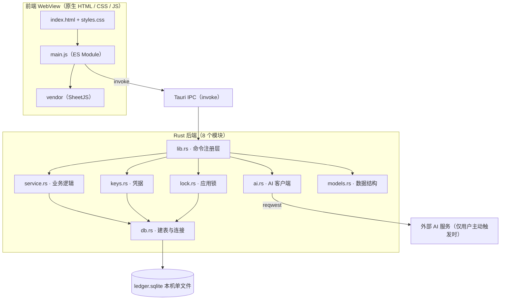

# Ledger 架构文档

> **语言**：[English](./ARCHITECTURE.en.md) ｜ **基线版本**：v1.5.0（commit `1b74e84`）｜ **最后核对**：2026-10-20

**一句话定位**：Ledger 是一个离线优先（offline-first）的个人记账本 —— Tauri v2 + Rust + SQLite 单机内核，前端零框架、零打包器、零构建步骤。

| 项 | 说明 |
|---|---|
| 读者对象 | 想读代码的 GitHub 访客、准备接手或二次开发的开发者、需要核对实现细节的使用者 |
| 与 README 的关系 | [README.md](./README.md) 回答「这是什么 / 怎么用 / 有哪些功能」；本文回答「系统怎么搭起来的 / 关键决策为什么这么定 / 能力边界止于何处」。功能清单与安装步骤不在本文重复 |
| 数据来源 | 全文所有数字均自 v1.5.0 源码实测（2026-10-20）。README 中已过期的数值（行数、"0 npm 依赖"等）以本文为准，详见 [§8 关键设计决策](#8-关键设计决策与取舍) 与 [§11 构建--测试--发布](#11-构建--测试--发布) |

---

## 1. 系统全景



### 1.1 分层职责

| 层 | 组成 | 职责 |
|---|---|---|
| 表现层 | `src/index.html` + `src/styles.css` + `src/main.js` | 全部 UI 与交互、统计计算、导出格式化；不含任何业务持久化逻辑 |
| 通信层 | Tauri IPC | 前端 `invoke(命令名, 参数)` → Rust `#[tauri::command]`，单窗口、无自定义协议 |
| 业务层 | `lib.rs` 注册的 36 个命令 + `service.rs` / `keys.rs` / `lock.rs` / `ai.rs` | 参数校验、金额换算、事务、凭据管理、AI 调用 |
| 存储层 | `db.rs` + `rusqlite` | 建表、种子数据、SQLite 单文件读写 |
| 外部依赖 | `ai.rs` 内的 `reqwest` | 仅在用户点「生成分析」时才出现，方向单一（应用 → 服务商） |

### 1.2 运行约束

| 约束 | 值 | 依据 |
|---|---|---|
| 网络 | **默认零出站**；不点「生成分析」不产生任何外部请求 | `tauri.conf.json` 的 CSP `connect-src 'self' ipc: http://ipc.localhost` 使 WebView 无法发起任意出站请求；所有 AI 请求都在 Rust 侧由 `reqwest` 发出（`ai.rs`） |
| 数据落地 | 单文件 `ledger.sqlite`，位于系统分配的应用数据目录，**不在仓库内** | `lib.rs` 的 `db_path()`（`app.path().app_data_dir()`）；`.gitignore` 排除 `*.sqlite` |
| 前端形态 | 无框架、无打包器、无构建步骤；`index.html` 以 `type="module"` 直接加载 `main.js`（`withGlobalTauri: true`） | `package.json`（devDependencies 不含任何打包工具）、`tauri.conf.json` 的 `frontendDist: "../src"` |
| 目标平台 | Android 7.0+（API 24+）、Windows 10+ | README 目标平台表；`capabilities/default.json` 仅声明主窗口 |
| 体积预算 | APK < 50 MB、Windows 安装包 < 10 MB（**目标值，非实测值**） | README 目标平台表 |
| 性能目标 | 冷启动 < 2s、单笔记账 ≤ 3s（**目标值，非实测值**） | README 目标平台表 |

> 说明：上表最后两行是项目设定的**目标**而非测量结果，本文不对未实测的性能数值做任何结论性表述。

### 1.3 产品定位（提炼自早期立项 / PRD / 用户故事）

- **目标用户**：想在 3 秒内记完一笔、不愿把账目上传云端、也不需要多账本与协作功能的轻量个人用户。
- **核心承诺**：记一笔足够快；数据只存本机；PC 与 Android 一套代码、体验一致。
- **沿用至今的非目标**：多用户 / 账号体系 / 云同步 / 多账本 / 多币种（详见 [§9](#9-已知边界与非目标)）。
- **与早期文档的两处偏差**：① 早期立项把「与 iOS 原生视觉高度一致」列为体验目标，现行主题已改为暖中性纸感 + 暗靛强调（[§13](#13-ui-设计语言)），该提法作废；② PRD 中 P1 的语音朗读 / 译文类功能从未实现，也不在路线图内。

---

## 2. 模块结构

### 2.1 前端（3 个源文件 + 1 个 vendor 目录）

| 文件 | 行数 | 职责 |
|---|---:|---|
| `src/index.html` | 773 | 全部页面结构：明细页 / 财报页 / 分类明细页 / 设置页，以及记账面板、日历、动作弹层、锁屏层、批量操作栏 |
| `src/main.js` | 4221 | 全部逻辑（ES Module，单文件）：状态、渲染、统计、导入导出、AI 面板、锁屏、主题 |
| `src/styles.css` | 2461 | 全部样式：主题变量、组件、动效 |
| `src/vendor/xlsx.full.min.js` | 951,904 B（约 929.6 KB） | SheetJS 0.20.3，随包分发（离线 + 规避 CVE），仅 Excel 导入路径按需加载 |
| `src/vendor/README.md` | — | 该 vendor 文件的来源、哈希、升级步骤 |

`main.js` 内部分区（按文件中的分隔注释）：

| 分区 | 主要产出 |
|---|---|
| 分类与规则 | `CATEGORIES` / `CAT_MAP` 加载、自定义关键词归类规则（`cat_rules`） |
| 明细页 | 月流水按天分组渲染、搜索、较上月环比、多选批量操作、侧滑删除、长按菜单（含单条改备注）、常用项胶囊 |
| 记账面板 | 数字键盘、金额输入、分类网格、日期日历、收藏为常用项、保存防重入 |
| 财报页 | 周期切换（年/月/周/天）、手写 SVG 圆环图、分类列表、近 6 个月趋势、支出/收入双视图 |
| 分类明细页 | 单个分类的月度明细与统计 |
| AI 面板 | 月度分析生成、缓存读写、隐私授权、Key 配置入口 |
| 设置页 | 预算、主题、应用锁、分类管理、导出/导入/清空 |
| 锁屏 | PIN 输入、解锁、设置/关闭流程 |
| 启动 | `boot()`：主题 → 锁 → 分类 → 规则 → 流水 → 月度预算；打开应用时的超支提醒 |

### 2.2 后端（8 个模块，共 2881 行）

| 模块 | 行数 | 职责 | 依赖 |
|---|---:|---|---|
| `main.rs` | 6 | 进程入口，调用 `ledger_lib::run()` | `lib` |
| `lib.rs` | 571 | 装配层：托管状态、注册 36 个命令、导出/导入实现、启动迁移 | 全部业务模块 |
| `db.rs` | 105 | 打开连接、幂等建表、种子分类、首次写入默认常用项 | `models`（隐含）、`rusqlite` |
| `models.rs` | 38 | 三个数据结构：`Transaction` / `Template` / `Category` | `serde` |
| `service.rs` | 947 | 金额与日期的解析校验、id 生成、CRUD、分类校验与删除保护、预算、settings 读写 | `models`、`chrono`、`rusqlite` |
| `keys.rs` | 339 | AI 配置读写、Key 三档存储、掩码回显、旧键迁移 | `service`、`ai`、`keyring` |
| `lock.rs` | 118 | 应用锁：PIN 格式校验、Argon2id 哈希、校验、关闭 | `service`、`argon2` |
| `ai.rs` | 757 | OpenAI 风格 HTTP 客户端：能力档位降级、错误映射、输出解析容错、TLS 配置 | `reqwest`、`rustls`、`serde_json` |

### 2.3 依赖方向

```
main.rs
  └─ lib.rs  （装配层，唯一持有 app.manage 状态的地方）
       ├─ service.rs ─┐
       ├─ keys.rs ────┼─> db.rs 的 Connection（由 lib.rs 注入）
       ├─ lock.rs ────┘        └─> models.rs
       └─ ai.rs  （不接触数据库，纯网络 + 解析）
```

约束：业务函数一律接收 `&Connection`（由调用方在锁内传入），**模块自身不持有连接、不开线程**；`ai.rs` 完全不感知数据库，因此可以跨 `await` 调用。

---

## 3. 命令契约（36 个）

来源：`lib.rs` 的 `invoke_handler` 清单（`lib.rs#L530-L567`）。下表 36 行与之逐项闭合，无多写、无少写。所有命令的失败路径统一返回 `Result<_, String>`，`String` 是可以直接展示给用户的中文提示。

**分组（7 组，合计 36）**：transactions 8 · budgets 2 · templates 4 · categories 6 · settings + lock 7 · ai 7 · data 2。

### 3.1 transactions（8）

| 命令 | 入参 | 返回 | 说明 |
|---|---|---|---|
| `list_all` | — | `Transaction[]` | 按 `date DESC, created_at DESC` 全量返回 |
| `add_tx` | `tx_type`, `amount`, `category`, `note`, `date` | `Transaction` | 金额字符串 → 分；校验分类存在且同类型、备注 ≤30 字 |
| `update_amount` | `id`, `amount` | `Transaction` | 只改金额，重新走金额校验 |
| `update_date` | `id`, `date` | `Transaction` | 日期窗口校验见 §5.1；日期未变时放行 |
| `update_note` | `id`, `note` | `Transaction` | 只改备注，走与 `add_tx` 相同的 `normalize_note`（trim 后 ≤30 字） |
| `delete_tx` | `id` | `bool` | 命中返回 `true` |
| `clear_all_tx` | — | `usize` | 清空 `transactions`，返回删除条数（**不动**分类/预算/常用项/settings） |
| `update_category_batch` | `ids: string[]`, `category` | `usize` | 批量改分类；目标分类必须与**每条**被选记录同向 |

### 3.2 budgets（2）

| 命令 | 入参 | 返回 | 说明 |
|---|---|---|---|
| `get_budget` | `month`（`YYYY-MM`） | `Option<f64>` | 无记录返回 `null`；前端按 `viewMonth` 调用，切月自动重取 |
| `set_budget` | `month`, `amount: Option<f64>` | `()` | 传 `null` 即删除该月预算条目 |

### 3.3 templates（4，即「常用项」）

| 命令 | 入参 | 返回 | 说明 |
|---|---|---|---|
| `list_templates` | — | `Template[]` | 常用项列表 |
| `add_template` | `tx_type`, `amount`, `category`, `note` | `Template` | 与流水同构，无日期字段 |
| `update_template` | `id`, `tx_type`, `amount`, `category`, `note` | `Template` | — |
| `delete_template` | `id` | `bool` | — |

### 3.4 categories（6）

| 命令 | 入参 | 返回 | 说明 |
|---|---|---|---|
| `list_categories` | — | `Category[]` | 按 `sort` 排序；缺失分类的兜底在 `service.rs` 内处理 |
| `add_category` | `cat_type`, `name`, `icon`, `color` | `Category` | 同一类型下分类名不重复 |
| `update_category` | `id`, `name`, `icon`, `color` | `Category` | **类型不可改**（界面锁定，避免既有记录串类） |
| `category_usage` | `id` | `usize` | 该分类被多少条流水引用（删除前提示用） |
| `delete_category` | `id`, `fallback: Option<string>` | `usize` | 兜底分类自身不可删；`fallback` 必须存在且同类型；返回被转移条数 |
| `reorder_categories` | `ids: string[]` | `()` | 按传入顺序重写 `sort`（事务内批量） |

### 3.5 settings + lock（7）

| 命令 | 入参 | 返回 | 说明 |
|---|---|---|---|
| `get_setting` | `key` | `Option<String>` | `settings` 键值表读 |
| `set_setting` | `key`, `value` | `()` | `INSERT ... ON CONFLICT DO UPDATE` |
| `delete_setting` | `key` | `bool` | — |
| `lock_status` | — | `{ enabled: bool }` | 需同时满足 `lock_enabled="1"` 且存在 `lock_pin_hash` |
| `lock_set_pin` | `pin` | `()` | 校验 4-8 位纯数字后写 Argon2id 哈希并自动启用 |
| `lock_verify` | `pin` | `bool` | 未设置哈希时一律放行（避免「无锁反而进不去」） |
| `lock_disable` | — | `()` | 置 `lock_enabled="0"` 并删除哈希 |

### 3.6 ai（7）

| 命令 | 入参 | 返回 | 说明 |
|---|---|---|---|
| `ai_config_get` | — | `AiConfigView` | 含 `keyHint` / `hasKey` / `keyringAvailable` / `isLocal` / `needsKey`；**Key 本体不回传** |
| `ai_config_set` | `provider`, `base_url`, `model`, `storage` | `()` | 保存服务商配置 |
| `ai_key_set` | `key`, `storage` | `String` | 按三档存储写入，返回掩码提示文本 |
| `ai_clear_analyses` | — | `usize` | 只删 `settings` 中 `ai_analysis_*` 缓存，不碰账目与 Key |
| `ai_key_clear` | — | `()` | 清除三档里的 Key |
| `ai_analyze` | `month`, `stats`（统计 JSON 字符串） | `AiResponse` | **async**；锁在 `await` 前释放；返回含 token 用量 |
| `ai_test_key` | — | `String` | **async**，设置页「测试连接」 |

### 3.7 data（2）

| 命令 | 入参 | 返回 | 说明 |
|---|---|---|---|
| `read_db_bytes` | — | `Vec<u8>` | 导出用；先落临时副本并剔除 `ai_api_key` / `deepseek_api_key` / `ai_key_hint`，任一步失败回退原始字节 |
| `import_db_data` | `data: Vec<u8>` | `usize` | SQLite 备份恢复，原子覆盖（详见 §6）；返回导入的流水条数 |

> 前端调用点示例：`add_tx` ← `saveTx()`（`main.js`）、`update_category_batch` ← 批量改分类、`update_note` ← 动作弹层「修改备注」、`read_db_bytes` ← `exportBackup()`、`import_db_data` ← `importBackup()`、`ai_analyze` ← 生成分析。36 个命令**全部**有前端调用点。

---

## 4. 数据模型

### 4.1 DDL（与 `db.rs#L15-L49` 逐字一致）

```sql
CREATE TABLE IF NOT EXISTS transactions (
    id           TEXT PRIMARY KEY,
    type         TEXT NOT NULL CHECK (type IN ('expense','income')),
    amount_cents INTEGER NOT NULL,
    category     TEXT NOT NULL,
    note         TEXT NOT NULL,
    date         TEXT NOT NULL,
    created_at   INTEGER NOT NULL
);
CREATE INDEX IF NOT EXISTS idx_tx_date ON transactions(date);
CREATE TABLE IF NOT EXISTS budgets (
    month        TEXT PRIMARY KEY,
    amount_cents INTEGER NOT NULL
);
CREATE TABLE IF NOT EXISTS templates (
    id           TEXT PRIMARY KEY,
    type         TEXT NOT NULL CHECK (type IN ('expense','income')),
    amount_cents INTEGER NOT NULL,
    category     TEXT NOT NULL,
    note         TEXT NOT NULL,
    created_at   INTEGER NOT NULL
);
CREATE TABLE IF NOT EXISTS categories (
    id      TEXT PRIMARY KEY,
    type    TEXT NOT NULL CHECK (type IN ('expense','income')),
    name    TEXT NOT NULL,
    icon    TEXT NOT NULL,
    color   TEXT NOT NULL,
    sort    INTEGER NOT NULL,
    builtin INTEGER NOT NULL DEFAULT 0
);
CREATE TABLE IF NOT EXISTS settings (
    key   TEXT PRIMARY KEY,
    value TEXT NOT NULL
);
```

### 4.2 索引与约束

| 项 | 内容 |
|---|---|
| 索引 | 仅 1 个：`idx_tx_date`（`transactions(date)`），服务月流水与分类明细查询 |
| 主键 | `transactions.id` / `templates.id` / `categories.id` / `budgets.month` / `settings.key` |
| 枚举约束 | `transactions.type` 与 `templates.type`、`categories.type` 均带 `CHECK IN ('expense','income')` |
| 外键 | **无**。`transactions.category` / `templates.category` 指向 `categories.id`，但未建 `FOREIGN KEY`，一致性靠 `service.rs` 的 `check_category` 与删除保护维持 |

### 4.3 值约定

| 值 | 库内形态 | 对外形态 |
|---|---|---|
| 金额 | `amount_cents INTEGER`（单位：分） | 字符串 `"12.34"`（`cents_to_string`），前端不做浮点运算 |
| 日期 | `TEXT`，`YYYY-MM-DD` | 同左 |
| 月份 | `budgets.month`，`YYYY-MM` | 同左 |
| 时间戳 | `INTEGER`，毫秒（`created_at`） | 同左，字段名序列化为 `createdAt` |
| 类型 | `TEXT`，"expense" / "income" | 序列化字段名为 `type` |
| id | `TEXT`，十六进制字符串（见 §5.1） | 同左 |
| 分类图标 | `TEXT`，图标 key（如 `utensils`），**不是 emoji** | 前端映射到内联 SVG |
| 分类颜色 | `TEXT`，色板值（如 `#FF9500`） | 同左 |

### 4.4 种子数据（13 条预置分类，`db.rs#L81-L96`）

| id | type | name | icon | color | sort |
|---|---|---|---|---:|---:|
| `food` | expense | 吃喝 | `utensils` | `#FF9500` | 1 |
| `transport` | expense | 交通 | `bus` | `#007AFF` | 2 |
| `shopping` | expense | 购物 | `shopping-cart` | `#FF3B30` | 3 |
| `entertain` | expense | 娱乐 | `gamepad-2` | `#AF52DE` | 4 |
| `home` | expense | 居住 | `home` | `#5856D6` | 5 |
| `medical` | expense | 医疗 | `pill` | `#FF2D55` | 6 |
| `study` | expense | 学习 | `book-open` | `#34C759` | 7 |
| `other` | expense | 其他 | `grid` | `#8E8E93` | 8 |
| `salary` | income | 工资 | `wallet` | `#00C7BE` | 1 |
| `bonus` | income | 奖金 | `gift` | `#FF9500` | 2 |
| `invest` | income | 理财 | `sparkles` | `#5856D6` | 3 |
| `redpack` | income | 红包 | `shopping-bag` | `#FF3B30` | 4 |
| `other_in` | income | 其他 | `grid` | `#8E8E93` | 5 |

写入时机：**仅当 `categories` 表为空时**写入一次，用 `INSERT OR IGNORE`；用户删掉的种子分类不会在下次启动复活。`id` 沿用历史硬编码值，保证旧流水 100% 能对上分类。

两个兜底分类常量在 `service.rs` 中固定为 `FALLBACK_EXPENSE = "other"`、`FALLBACK_INCOME = "other_in"`（`service.rs#L83-L84`）。

默认常用项 2 条（`tpl-meal` 吃饭 ¥20 / `tpl-metro` 地铁 ¥5），仅在 `templates` 表**本机首次创建**时写入一次（`db.rs#L62-L73`）；删除后不再生成。

### 4.5 Schema 版本策略

**当前没有 schema 版本号表**，也没有迁移脚本框架。策略如下，及其边界：

| 做法 | 效果 | 边界 |
|---|---|---|
| 全部建表语句 `CREATE TABLE IF NOT EXISTS` | 新表可增量追加，老库启动即补齐 | 无法表达「改列 / 改约束」 |
| 新增列时不在旧库补列 | 新代码读取旧库缺列会直接报错 | 需要新列时必须手写迁移（当前走的是「新增整张表」路线） |
| 导入按表存在性分支 | 缺 `budgets` / `templates` / `categories` 的旧备份自动跳过 | 缺列仍不支持 |

已发生的两处兼容处理：① 旧 `settings` 键 `deepseek_api_key` → `ai_api_key` 的迁移（`keys::migrate_legacy`）；② 三个表（budgets / templates / categories）是**追加**出来的，旧备份没有即跳过。

---

## 5. 状态与并发

### 5.1 后端

| 机制 | 实现 | 出处 |
|---|---|---|
| 连接托管 | 单条 `Mutex<Connection>` 由 `app.manage(Mutex::new(conn))` 托管，命令通过 `tauri::State` 取用 | `lib.rs#L512-L529`（`run()` 的 `setup`）；`app.manage` 在 `#L526-L527` |
| 锁作用域 | 同步命令持锁完成即释放；**async 命令必须先收敛锁、不得跨 `await` 持锁**（`ai_analyze` / `ai_test_key` 用内层块先取出 `api_key` 与配置再 `await`） | `lib.rs#L291-L339` |
| 金额解析 | 逐位校验：非空、不以 `.` 开头、至多 1 个小数点、整数位 ≤9 位、小数位 ≤2 位、结果 >0 | `service.rs#L10-L40` |
| id 生成 | 毫秒时间戳 + 进程内自增 `ID_SEQ`（从 1 起）+ 奇数倍双射混淆 low32。仅用毫秒时，同毫秒两次写入会撞 `PRIMARY KEY`；seq 从 1 起避免与「旧版本纯毫秒 id」撞车 | `service.rs#L69-L81`（`ID_SEQ` 在 `#L69`） |
| 分类校验 | `check_category` 要求分类存在且 `type` 与记录一致 | `service.rs#L86-L102` |
| 备注规范化 | `trim()` 后按字符数 ≤30 | `service.rs#L104-L111` |
| 日期窗口 | 修改日期限制在「今天 ± 365 天」（`EDIT_DATE_MAX_DAYS = 365`，`#L7`）；**但若新日期与原日期相同则放行**（否则导入的历史账单连原样保存都会被拒） | `service.rs#L181-L203` |
| 删除保护 | 兜底分类不可删；`fallback` 必须存在且与被删分类同类型；转移 + 删除在同一事务内 | `service.rs#L641-L695` |
| 批量改分类 | 目标分类必须与**每条**被选记录同向，否则整批拒绝（防统计串类） | `service.rs#L230-L296` |
| 事务 | 使用 `unchecked_transaction()`（连接已被外部 Mutex 保护，无需再借 `&mut`） | `service.rs#L286`、`#L680`、`#L698` |
| 错误形态 | 全部 `Result<_, String>`，提示语为可直接展示的中文；网络错误经 `status_error` / `network_error` 映射 | `ai.rs#L169-L198` |

### 5.2 前端

| 机制 | 实现要点 | 出处 |
|---|---|---|
| 面板注册表 | 所有弹层集中在 `allPanels` 数组，`openModal/closeModal` 统一开关与取消处理；**新面板漏注册会表现为「黑屏无反应」** | `main.js#L1415-L1458` |
| 面板互斥 | `activePanel` 记录当前弹层，键盘事件与「返回」先关弹层再关面板，避免事件穿透 | `main.js#L1420`、`#L1436`、`#L1454`、`#L2585` |
| 记账态 | `curType`（"expense"/"income"）与 `editingTemplateId`（`null` = 新记账，非空 = 正在改常用项）；后者决定保存走 `add_tx` 还是 `update_template` | `main.js#L2310`、`#L2320-L2321`、`#L2515-L2531` |
| 保存防重入 | `savingTx` 守卫，`if (savingTx) return`，避免双击/回车重复记一笔 | `main.js#L2499`、`#L2501-L2512` |
| 查看月份 | `viewMonth`（`YYYY-MM`）；切月必须重新 `loadBudget()`，否则会沿用上月的预算额度 | `main.js#L248`、`#L1252`、`#L1819` |
| 锁屏层 | 默认 `display:none`，仅当 JS 移除 `hidden` 属性时显示；切后台（`visibilitychange` + `document.hidden` 且已启用锁）重新锁定 | `index.html#lockOverlay`（L757）、`main.js#L4021`、`#L4038`、`#L4163-L4166` |
| 分钟级重绘 | 定时器仅在「页面可见**且**跨天」时 `renderHome()`；无条件重绘会让带入场动画的列表每分钟重播动画、还会把已侧滑打开的行收回 | `main.js#L4204-L4214` |
| 日期选择防呆 | 日历只允许在当前月 ±2 个月内翻页（`calRange()` 给出 `min`/`max`，边界处禁用箭头），超界日期渲染为不可点的 `.cal-day.off` | `main.js#L2402-L2426`（防呆在 `#L2404-L2408`） |
| 月份视图范围 | 明细页可切月份限制为「前 12 个月 ~ 后 3 个月」（`monthShiftAllowed`） | `main.js#L1810`、`#L1819` |
| 主题 | 三态：跟随系统（`prefers-color-scheme`）/ 显式 `data-theme="dark"` / `data-theme="light"` | `styles.css#L59-L127`、`main.js#L4179` |
| 交互防抖 | 常用项胶囊 350ms 内防连点；长按 500ms 进入多选（横滑/抖动 >8px 取消） | `main.js` 常用项与列表手势段 |

---

## 6. 安全与隐私边界

| 主题 | 现状 | 边界说明 |
|---|---|---|
| 默认零网络 | 不点「生成分析」不产生任何出站请求 | CSP `connect-src` 只放行 `self` 与 IPC，WebView 无法自行出站；网络能力集中在 Rust 侧 |
| 应用锁 | 4-8 位纯数字 PIN，Argon2id 哈希 + 随机盐写入 `settings`（`lock_enabled` / `lock_pin_hash`） | **不加密磁盘数据库文件**。它是「防他人在这台设备上误看」，磁盘级加密属于另一层能力，**刻意不做**（`lock.rs` 头注释已声明） |
| PIN 校验 | 本地比对，不联网、不落盘明文；未设置哈希时一律放行 | 无重试次数限制、无锁定延时（当前实现未做） |
| API Key 存储 | 三档：① 系统钥匙串（仅 Windows / macOS，`keyring` 条件编译）② 本机数据库（`ai_api_key`）③ 仅内存（进程内 `Mutex<Option<String>>`，退出即失效）。Android 上钥匙串不可用时回落 | `keys.rs#L10-L77`；界面只回显前 3 后 4 位掩码（≤8 位时回显 `••••`） |
| Key 迁移 | 旧键 `deepseek_api_key` 启动时迁移到 `ai_api_key` | `keys::migrate_legacy`（`keys.rs#L277`），调用点 `lib.rs#L525` |
| 备份不带凭据 | 导出先复制库文件到临时副本，`DELETE FROM settings WHERE key IN ('ai_api_key','deepseek_api_key','ai_key_hint')`，再读字节；**任一步失败回退原始字节** | `lib.rs#L341-L371`（剔除语句在 `#L353`） |
| 导入范围 | 只覆盖 `transactions` / `budgets` / `templates`，`categories` 按 id **合并**（不整表清空）；**不含任何设置项**（密码、API Key、隐私授权、自动归类规则） | `lib.rs#L372-L505`；导入确认文案需明确这一点 |
| 导入原子性 | 写临时文件 → `ATTACH DATABASE`（`#L391`）→ 校验 `sqlite_master` 确有 `transactions` 表（`#L399`）→ 事务内 `DELETE` + `INSERT`（`#L469`、`#L480`、`#L491`）→ `COMMIT` → `DETACH` + 删临时文件；任一步失败均清理临时文件并 `DETACH` | `lib.rs#L372-L505` |
| 分类合并理由 | 若分类整表清空，备份缺分类会把兜底分类「其他」一起删掉，导致记录退化成同名多行「其他」 | `lib.rs#L446-L491` 注释 |
| 权限声明 | `capabilities/default.json`：`core:default`、`opener:default`、`dialog:default`、`fs:default`、`fs:allow-write-file`，仅作用于 `main` 窗口 | 无 shell / http / 网络类插件权限 |
| TLS | `reqwest` 走 rustls + ring + 内置 Mozilla 根证书（`webpki-roots`），ALPN 优先 h2 | `ai.rs#L200-L226`（`use_preconfigured_tls` 在 `#L223`）。改用内置根证书是因为 `rustls-platform-verifier` 在 Android 需手动 JNI 初始化，否则握手 panic |

---

## 7. AI 子系统

AI 分析是**可选能力**，不配置也能用完整个应用；所有请求只在用户点击时发起。

### 7.1 能力档位降级状态机

```
档位 1：json_mode=true  + thinking=true     ← 仅当 provider/base 命中 deepseek
档位 2：json_mode=true  + thinking=false    ← 仅当档位 1 存在时才有
末档　：json_mode=false + thinking=false
```

逐档调用，命中即返回；`capability == true`（参数不被支持）且还有下一档时继续降级，否则抛出最后一条错误（`ai.rs#L150-L159` 的 `profiles()`、`#L471-L490` 的降级循环）。

### 7.2 判定与适配规则

| 规则 | 内容 |
|---|---|
| 可重试判定 | 仅 `400 / 404 / 422` **且**响应体命中 `response_format` / `json_object` / `thinking` / `unsupported` / `not support` / `invalid_request` 关键字时，才判定为「参数不支持」 |
| 状态码映射 | `401/403` → Key 无效或过期；`402` → 余额不足；`404` → Base URL 错误；`429` → 请求过于频繁；`5xx` → 服务暂不可用 |
| thinking | 只发给 DeepSeek（provider 或 base URL 命中 `deepseek`） |
| temperature | 推理类模型（`reasoner` / `reasoning` / `r1` / `o1` / `o3` / `o4` / `thinking`）自动去掉 |
| 本地地址 | `localhost` / `127.0.0.1` / `::1` / `0.0.0.0` / `*.local` / `host.docker.internal` / `10.x` / `192.168.x` / `172.16-31.x` / `169.254.x` 视为自建服务：**免 Key**，超时放宽到 120s（云端 45s） |
| Base URL 归一化 | 自动补 `/chat/completions`；已含该路径则不重复拼接（`endpoint()`，`ai.rs#L104`） |
| Token 上限 | `max_tokens = 2000` |
| 系统提示词 | 强制要求出现 "json" 字样并给出示例结构（OpenAI 兼容 JSON Output 的前提） |

### 7.3 输出解析容错

模型（尤其是小模型）输出常不规范，解析分两级（`ai.rs#L318-L445`）：

1. **严格解析**：先剥离 ``` 围栏 → 取首个 `{` 到末个 `}` → `serde_json` 反序列化为 `AiResult`；字段齐全且有内容即返回。
2. **宽松解析（救回）**：字段别名兜底 —— `summary` / `结论` / `总结` / `概述`；`advice` / `建议` / `suggestions`；分类数组 `categories` / `分类`（最多取 12 条）；单条内 `name`/`分类`/`category`、`amount`/`金额`、`share`/`占比`、`verdict`/`评价`/`status`、`comment`/`点评`/`说明`/`reason`；数字兼容字符串形态。
3. 两级都拿不到内容 → `Err("AI 返回内容为空，请重试")`。

### 7.4 缓存与清理

月度分析结果以 `settings` 键 `ai_analysis_<YYYY-MM>` 缓存（前端写入，见 `main.js#L3750`、`#L3803`）；`ai_clear_analyses` 按前缀 `ai_analysis_` 批量删除，只动缓存、不动账目与 Key。前端「是否把备注发给 AI」由 `ai_include_notes` 控制，首次使用需通过 `ai_privacy_accepted` 授权。

---

## 8. 关键设计决策与取舍

| 决策 | 理由 | 被否决 / 未采用的替代方案 |
|---|---|---|
| 全量 `list_all` 不分页、统计在前端算 | 单机个人账本量级小（月流水百条级）；一次拉取让路由与缓存全部消失，交互即时 | 后端分页 + 聚合接口：为不存在的规模付复杂度 |
| 金额用整数「分」+ 对外字符串 `"12.34"` | 彻底规避浮点误差；字符串传输让前端只做展示与拼接，不做数值运算 | 前端 `Number`/`float` 直接算：`0.1+0.2` 类误差会进入账本 |
| id = 毫秒 + 进程内自增 + 双射混淆 | 仅毫秒会在同毫秒写入时撞主键（批量导入尤甚），表现为「部分记录被静默丢弃」 | UUID：需要新依赖且可读性差；纯自增：跨设备/导入合并会冲突 |
| 零框架、零打包器、零构建 | 改完存盘刷新即生效；无 npm 依赖链、无供应链面；`index.html` 直接 `type="module"` 加载 | Vite/React：对于一个单窗口账本属于纯负担 |
| SheetJS 0.20.3 随包分发（vendored） | 保证离线；npm 上 `xlsx` 停在 0.18.5 且有未修复漏洞（CVE-2023-30533 原型污染、CVE-2024-22363 ReDoS），而本项目正解析用户从支付宝/微信导出的外部文件，属高危触发场景 | 运行时 CDN 拉取：破坏离线承诺、执行远程代码；npm 0.18.5：带已知漏洞 |
| Excel 库按需动态加载 | CSV 路径完全不碰它，因此不影响冷启动 | 首屏静态引入：为极少数导入操作拖慢每次启动 |
| 手写 SVG 圆环图 | 一条 `stroke-dasharray`/`stroke-dashoffset` 过渡即可，无需图表库 | Chart.js/ECharts：体积与依赖都不划算 |
| rustls + ring + 内置根证书，避开 OpenSSL | Windows 与 Android 编译都不需要 cmake / nasm / OpenSSL；避免 Android 上 platform-verifier 的 JNI 初始化问题 | openssl：跨平台编译负担；platform-verifier：Android 需手动初始化，否则握手 panic |
| Argon2id 做 PIN 哈希 | 纯 Rust、无 C 依赖链；慢哈希适合抵御离线爆破 | 明文 / MD5：不可接受；bcrypt：需要 C 依赖 |
| 导入分类「按 id 合并」而非整表覆盖 | 备份缺分类时若清空，会把兜底分类「其他」一起删掉，记录退化成多行同名「其他」 | 整表 DELETE + INSERT：会破坏兜底分类；按记录 fallback 重挂：批量场景语义复杂 |
| 导入不覆盖任何设置项 | 备份是「账目数据」载体，不是「设备配置」载体；把密码/Key/授权搬来会跨设备串味，且有安全风险 | 全库覆盖：会把另一台设备的凭据带过来 |
| Key 三档存储而非强制钥匙串 | 桌面有系统凭据管理器，移动端没有；强制单一方案会在某一平台直接不可用 | 只存数据库：桌面端白白降低安全性；只存内存：每次启动都要重填 |
| 无 schema 版本号，只做 `CREATE TABLE IF NOT EXISTS` | 项目处于单文件单机形态，新增能力一律「新增整张表」，从不需要改列 | 迁移框架（如 refinery）：为当前不存在的需求引入依赖 |
| 删除分类时把记录转到兜底分类 | 不产生孤儿记录；统计不会因分类消失而丢金额 | 级联删除记录：用户会丢数据 |

---

## 9. 已知边界与非目标

**明确不做**（有意留白，不做「半成品」）：

| 项 | 边界说明 |
|---|---|
| 云同步 / 账号体系 / 多设备 | 数据主权优先；迁移靠应用内导出/导入 |
| 磁盘级加密 | 应用锁只防误看，不加密库文件；未越界实现 |
| 服务端 / 后端 API | 无远程服务，全部逻辑在本机 |
| 插件化 / 主题市场 | 单窗口单主题两套色板即够 |
| 社交、游戏化提醒、引导流程 | 产品刻意做减法 |
| 多账本 / 多币种 / 汇率转换 | 立项范围即明确排除，当前是单账本、单币种 |
| 图表导出（PNG 图片） | 只支持把流水导出为 xlsx / csv、把整库导出为 sqlite 备份，不导出图表图片 |
| 语音朗读 / 译文类功能 | 早期 PRD 的该项从未实现，未列入路线图 |
| 自动化前端测试 | 无 E2E 框架；前端为手工验收（见 §15） |

**已知能力边界（现状即为受限实现）**：

| 项 | 现状 |
|---|---|
| schema 变更 | 无迁移框架，只能新增整张表（§4.5） |
| 损坏数据库 | 打开失败直接返回错误，**不自动回退空库**（`lib.rs#L521-L522`）；用户需靠备份恢复 |
| PIN 爆破防护 | 无尝试次数限制与延时 |
| 导入范围 | 不含设置项；缺列的新旧备份不兼容 |
| 前端规模 | 单文件 `main.js` 4221 行，无模块拆分；靠分区注释维持可读性 |
| 查询规模 | 全量加载 + 前端过滤；未做分页/虚拟列表，超大账本（万条以上）未做性能验证 |

**与早期课程文档的差异说明**：项目早期文档集（`ledger document/`，从未纳入版本控制）中的若干描述已与现状不符，本文不沿用。典型三处：① 其 UI 规范写的是 iOS 系统色（`#F2F2F7` / `#007AFF` / 24px 圆角），现行主题是暖中性纸感 + 暗靛，实测值见 §13；② 其数据库文档只描述 1 张表，实际为 5 张（§4）；③ 其测试计划中的「改日期为 400 天前一律拒绝」与现状相反（现状允许**未修改日期**的原样保存）、「数据文件损坏回退空账」在代码中并未实现。

---

## 10. 文件地图

```
ledger/
├── src/                          前端（原生 HTML/CSS/JS，无构建）
│   ├── index.html                773 行 · 全部页面结构
│   ├── styles.css                2461 行 · 主题变量与全部样式
│   ├── main.js                   4221 行 · 全部逻辑（ES Module）
│   └── vendor/
│       ├── xlsx.full.min.js      SheetJS 0.20.3，随包分发（951,904 B）
│       └── README.md             来源 / SHA-256 / 升级步骤
├── src-tauri/                    Rust 后端
│   ├── src/
│   │   ├── main.rs               6 行 · 入口
│   │   ├── lib.rs                571 行 · 36 个命令注册 + 导入导出 + 启动迁移
│   │   ├── models.rs             38 行 · Transaction / Template / Category
│   │   ├── db.rs                 105 行 · 建表与种子数据
│   │   ├── service.rs            947 行 · 业务逻辑
│   │   ├── keys.rs               339 行 · API Key 三档存储
│   │   ├── lock.rs               118 行 · 应用锁
│   │   └── ai.rs                 757 行 · AI 客户端
│   ├── capabilities/default.json 权限声明（仅 main 窗口）
│   ├── icons/                    应用图标
│   ├── gen/android/              Android Gradle 工程（已入库，编译产物不入库）
│   ├── Cargo.toml / Cargo.lock
│   └── tauri.conf.json           窗口、CSP、打包配置
├── docs/                         截图（detail.png / account.png / stats.png）
├── .trae/                        本地开发辅助目录（已由 .gitignore 排除）
├── README.md                     面向使用者与开发者的入口文档
├── ARCHITECTURE.md               本文件
├── ARCHITECTURE.en.md            英文版
├── CHANGELOG.md                  版本更新日志（回填自 git 提交与 Release）
├── LICENSE                       MIT
├── package.json                  仅一个脚本 `tauri`，仅一个 devDependency `@tauri-apps/cli`
├── package-lock.json
├── .gitignore / .gitattributes / .editorconfig
└── .traeignore / .vscode/
```

**不入库的东西**（`.gitignore` 明确排除）：`node_modules/`、`target/`、`src-tauri/gen/android/` 下的编译产物（`build` / `.gradle`）、APK/AAB/MSI/EXE、Android 签名文件与凭据、`*.sqlite*`（真实账目）、本地备份与离线文档目录、本地开发辅助目录 `.trae/`。

> 仓库当前受版本控制的文件 96 个；数据库文件 `ledger.sqlite` 由系统应用数据目录承载，克隆仓库不会带上任何真实账目。
>
> `.trae/` 是本地开发辅助目录，已在 `.gitignore` 中排除，不会进入版本控制，也不再以未跟踪状态出现在 `git status` 里。

---

## 11. 构建 / 测试 / 发布

### 11.1 环境准备

| 依赖 | 用途 |
|---|---|
| Rust（<https://rustup.rs>） | 编译后端 |
| Node.js 18+ | 运行 Tauri CLI（**不是构建前端**，前端无构建步骤） |
| Android：Android Studio + NDK + JDK 17 + `ANDROID_HOME` / `NDK_HOME` | Android 目标 |
| Windows：Microsoft C++ 生成工具 + WebView2 | Windows 目标 |

### 11.2 常用命令

```bash
npm install                    # 安装 @tauri-apps/cli 与三个运行时依赖

npm run tauri dev              # 桌面端开发（热重载）

npm run tauri android init     # 生成 gen/android 工程（首次；该目录已入库，克隆后无需再跑）
npm run tauri android dev      # 真机 / 模拟器调试

npm run tauri android build    # 产出 APK / AAB
npm run android:release:arm64  # 便捷脚本：直接产出 arm64 release APK（见 11.4）

npm run tauri build            # Windows 桌面端（NSIS / MSI）

cd src-tauri && cargo test     # 24 个单元测试（23 个执行 + 1 个被 ignore 的联网测试）
cd src-tauri && cargo test -- --ignored   # 单跑那条联网测试
```

> 前端**没有** build/dev 脚本；`index.html` 由 `tauri.conf.json` 的 `frontendDist: "../src"` 直接指向。

### 11.3 版本升级

一个版本号写在 4 处，必须同步：

| 文件 | 字段 |
|---|---|
| `package.json` | `version` |
| `src-tauri/tauri.conf.json` | `version` |
| `src-tauri/Cargo.toml` | `package.version` |
| `src-tauri/Cargo.lock` | 由 `cargo` 构建时自动更新（不要手改） |

### 11.4 发布产物

| 平台 | 产物 | 命名 |
|---|---|---|
| Android | APK / AAB | `Ledger-<版本号>-arm64.apk`（与历史版本保持一致） |
| Windows | NSIS / MSI | 由 Tauri Bundler 生成 |

注意事项：Windows 下未开启开发者模式时，Tauri 构建 aarch64 APK 会因无法创建符号链接而失败 —— 需开启开发者模式或用管理员终端运行构建命令。

`android:release:arm64` 脚本产出的文件名是 Gradle 的默认名 `app-arm64-release.apk`；**上传 Release 前需手工改名为 `Ledger-<版本号>-arm64.apk`**（脚本不做重命名），否则会与历史 Release 资产命名不一致。

### 11.5 测试与自检

`cargo test` 覆盖 24 个用例（分布见 §15）。所有断言与连接均使用内存库或 `TcpListener` mock 服务端，不触碰真实数据文件。

### 11.6 产物路径

| 平台 | 命令 | 预期产物路径（Tauri Bundler 默认约定） |
|---|---|---|
| Windows | `npm run tauri build` | `src-tauri/target/release/bundle/nsis/ledger_<版本>_x64-setup.exe`（另有 MSI） |
| Android | `npm run tauri android build` | `src-tauri/gen/android/app/build/outputs/apk/<abi>/release/` 下的 APK（上架另出 AAB） |

### 11.7 Android 正式签名（已配置）

release 签名已在 `src-tauri/gen/android/app/build.gradle.kts` 接好：`buildTypes.release` 使用名为 `release` 的 `signingConfig`，并同时开启 `isMinifyEnabled`；签名参数从 `src-tauri/gen/android/gradle.properties` 读取：

| 键 | 含义 |
|---|---|
| `LEDGER_KEYSTORE` | 密钥库路径（相对 `gen/android` 根目录解析，不是 `app/` 模块目录） |
| `LEDGER_KEYSTORE_PASSWORD` | 密钥库口令 |
| `LEDGER_KEY_ALIAS` | 别名 |
| `LEDGER_KEY_PASSWORD` | 别名口令 |

密钥库文件为 `src-tauri/gen/android/ledger-release.keystore`。因此 `--apk` 出的是**已正式签名**的 release 包，不是 debug 包。

**这些文件一律不入库**：`.gitignore` 排除 `src-tauri/gen/android/*.keystore` 与 `src-tauri/gen/android/gradle.properties`（内含签名口令），`gen/android/.gitignore` 排除 `local.properties`。换机器时需补齐这四个键并放入对应 keystore：

```bash
keytool -genkey -v -keystore ledger-release.keystore -alias <别名> -keyalg RSA -keysize 2048 -validity 10000
```

⚠️ 密钥库一旦更换，Android 会视为另一个应用：已安装用户无法直接覆盖升级，需卸载重装。

### 11.8 常见问题

| 问题 | 处理 |
|---|---|
| 安装提示「未知来源」 | 在 Android 设置中允许该来源安装 |
| 打开即闪退 | 检查系统版本（需 Android 7.0+ / API 24+）与 CPU 架构（APK 为 arm64） |
| 数据不见了 | 库文件由系统应用数据目录承载，检查是否被外部清理工具删除；用「导入数据」从备份恢复 |
| 界面显示不全 | 记录设备分辨率与系统版本后反馈 |

> 早期运维手册把「导出/导入」「预算管理」列为「规划中」，这两项在 v1.4.0 均已实现（且导出导入已迭代为 xlsx / csv / sqlite 三格式），本条不再沿用。

---

## 12. 变更指南（接手者最短路径）

| 你想做的事 | 必须动的地方 | 漏做会怎样 |
|---|---|---|
| 新增一个后端命令 | ① 在对应模块写 `#[tauri::command] fn`；② **注册进 `lib.rs` 的 `invoke_handler`**；③ 前端 `invoke` 调用；④ 按需补单测 | 不注册 → 前端报「命令不存在」 |
| 新增一个面板（弹层） | ① `index.html` 加结构；② **注册进 `main.js` 的 `allPanels`**；③ 走统一的取消/关闭处理 | 不注册 → 黑屏无反应 |
| 新增一张表 | 只改 `db.rs`，建表语句必须 `IF NOT EXISTS`；种子数据只在「表首次创建/首次为空」时写 | 幂等失效 → 每次启动重复写种子 |
| 新增一个设置项 | 用 `settings` 键值表，无需建表；若需从备份中排除，注意 `read_db_bytes` 的剔除清单 | 凭据外泄进备份 |
| 改前端主题色 / 圆角 | 只改 `styles.css` 的 `:root` 变量；深色在同文件的 `@media (prefers-color-scheme: dark)` 与 `[data-theme="dark"]` 两处 | 只改浅色 → 深色下不一致 |
| 改导入覆盖范围 | `lib.rs` 的 `import_db_data`（表存在性分支 + `INSERT OR REPLACE ... SELECT`）；同步改前端导入确认文案 | 文案与实际范围不符，误导用户 |

**硬约束（改动时不得破坏）**：

1. 不得破坏侧滑删除、点击弹菜单、搜索这三条既有交互。
2. 不引入新依赖（前端不引入框架/打包器；后端新增 crate 需明确理由）。
3. 金额永远以「分」整数落库、以字符串出传输，不得在任一侧引入浮点运算。
4. async 命令不得跨 `await` 持有数据库锁。
5. 文档与提交署名只署项目作者 `SolitaryStarCircling`，不得出现任何 AI 工具或协作方署名。

---

## 13. UI 设计语言

主题是**「暖中性纸感 + 暗靛强调」**，不是任何平台的系统色。以下数值全部实测自 `styles.css#L2-L57`（浅色 `:root` 块），深色块见同文件 `#L59-L127`。

### 13.1 主题变量（浅色）

| 类别 | 变量 → 值 |
|---|---|
| 背景 | `--bg: #F4F3F1`（暖纸）/ `--canvas: #ECEAE6` / 三层环境光晕 `--glow-1..3`（低透明度蓝紫绿） |
| 材质（毛玻璃） | `--card: #FFFFFF` / `--card-sub: #F8F7F5` / `--glass: rgba(255,255,255,0.78)` / `--glass-strong: rgba(255,255,255,0.92)` / `--sheet-bg: rgba(244,243,241,0.86)` |
| 填充与分隔 | `--fill: rgba(28,26,23,0.055)` / `--fill-strong: rgba(28,26,23,0.10)` / `--sep: rgba(28,26,23,0.065)` / `--hairline: rgba(255,255,255,0.80)` |
| 文字 | 四级：`--text: #1B1A18`（暖近黑）→ `--text2: rgba(85,81,75,0.72)` → `--text3: rgba(140,134,127,0.82)` |
| 语义色 | 强调 `--blue: #58619D`（暗靛）+ `--blue-soft: #EDEEF6`；收入 `--green: #5E7A63`；危险 `--red: #A2605C`（均低饱和） |
| 圆环分片 | `--seg-1: #58619D` / `--seg-2: #8E97B8` / `--seg-3: #9AA88F` / `--seg-4: #C0A98E` / `--seg-5: #D6D2CB`（同家族低饱和） |

深色通过两个通道同时支持：`@media (prefers-color-scheme: dark)`（跟随系统，`styles.css#L59-L93`）与 `[data-theme="dark"]`（显式切换，`#L95-L127`），显式浅色用 `[data-theme="light"]` 覆盖。

### 13.2 形状与质感

| Token | 值 |
|---|---|
| 圆角 | `--r-xs: 10px` / `--r-sm: 12px` / `--r-md: 14px` / `--r-lg: 22px` / `--r-xl: 22px` |
| 阴影 | 三级极淡：`--sh-1`（贴地）/ `--sh-2`（卡片）/ `--sh-3`（浮层），另有语义阴影 `--sh-blue` / `--sh-red` |
| 模糊 | `--blur: 20px` / `--blur-lg: 30px` / `--sat: 140%` |
| 间距 | 4px 栅格 |
| 字体栈 | `-apple-system, BlinkMacSystemFont, "SF Pro Text", "PingFang SC", "Helvetica Neue", "Microsoft YaHei", sans-serif`（`body`），按钮与输入框 `font-family: inherit` |
| 字号与字重 | 尺寸按组件各自声明，不设全局阶梯。实测分布：主金额 45px（明细页）/ 44px、42px 级数（财报）、页面标题 34px、弹层标题 20px（700）、正文与设置行 16–17px（500–600）、次要说明 13px、tab 标签 10px（500） |
| 字距 | 大号金额使用负字距（`-2.5px` / `-1.4px` / `-1px`），小标签使用正字距（`0.1px`–`0.6px`） |

### 13.3 分类视觉

13 条预置分类的 `icon` / `color` 以 `db.rs#L81-L96` 为准（见 §4.4 表）。`icon` 是**图标 key**，前端映射为内联 SVG（如 `utensils` / `bus` / `shopping-cart` / `gamepad-2`），**不是 emoji**；`color` 是分类自身的色板值，与主题语义色无关。

### 13.4 动效

| 场景 | 曲线 / 时长 |
|---|---|
| 抽屉与面板入场 | `cubic-bezier(.32,.72,0,1)` |
| 按压回弹 | `cubic-bezier(.34,1.56,.64,1)` |
| 列表项入场 | `fadeUp .45s cubic-bezier(.2,.8,.2,1)` |
| 圆环图描边 | `stroke-dasharray` 过渡 `.85s` |
| 超支提醒卡 | 红色警示样式，停留 3.2s（普通成功卡 1.6s） |

弹层的入场淡入动画**只在 `.show` 时触发**，保证每次打开都是重新错峰淡入。

---

## 14. 交互与状态机

### 14.1 信息架构

```
明细页（首页）
├─ 顶部：月份切换 / 搜索 / 本月支出·收入·结余 / 较上月环比 / 预算条
├─ 常用项胶囊行（搜索或多选时隐藏）
└─ 按天分组的流水列表
     ├─ 点击行 → 动作弹层（修改金额 / 修改时间 / 修改备注 / 多选 / 删除）
     ├─ 侧滑 → 删除
     ├─ 长按 500ms → 进入多选（底部批量栏：全选 / 改分类 / 取消）
     └─ 长按常用项胶囊 420ms → 修改 / 删除常用项

记账面板（悬浮主钮「记一笔」）
├─ 支出 / 收入分段
├─ 数字键盘 + 金额显示
├─ 分类网格（含「管理分类」入口）
├─ 日期按钮 → 日历弹层（当前月 ±2 个月）
├─ 备注（≤30 字）
└─ 收藏为常用项

财报页
├─ 周期切换（年 / 月 / 周 / 天）
├─ 支出 / 收入双视图
├─ 圆环图 + 分类列表（点击进入分类明细）
└─ 近 6 个月趋势 / AI 分析面板

分类明细页 · 设置页 · 锁屏层
```

### 14.2 四条核心流程

| 流程 | 步骤 |
|---|---|
| 记一笔 | 打开面板 → 选类型 → 键盘输金额 → 选分类 → （可选）改日期、填备注 → 保存。保存有 `savingTx` 防重入；若处于「修改常用项」态则改走 `update_template` |
| 改金额 | 点流水行 → 动作弹层「改金额」→ 编辑键盘 → 保存（`update_amount`） |
| 改备注 | 点流水行 → 动作弹层「修改备注」→ 输入框编辑（≤30 字，可清空）→ 保存（`update_note`） |
| 侧滑删除 | 左滑行 → 露出删除按钮 → 确认（`delete_tx`）；多选态下可批量处理 |

### 14.3 状态要点

| 状态 | 约束 |
|---|---|
| `curType` + `editingTemplateId` | 两者必须一致：`editingTemplateId` 非空时会先按该常用项的 `type` 回填 `curType` 与金额/分类/备注 |
| `activePanel` | 有弹层时键盘事件与「返回」优先作用于弹层，避免穿透 |
| `allPanels` | 面板集中注册；统一 `show/hide` 与取消处理 |
| `viewMonth` | 切月必须 `loadBudget()`；预算与月份强绑定，不做跨月自动沿用 |
| 锁屏 `hidden` | 层默认 `display:none`，JS 移除 `hidden` 才显示；切后台自动回到验证态 |
| 搜索 / 多选态 | 隐藏常用项胶囊行与预算展示行（首页「较上月环比」行在搜索态同样隐藏，避免与跨月过滤结果对不上），退出后恢复 |

---

## 15. 测试策略

### 15.1 后端单元测试（24 个：23 执行 + 1 `#[ignore]`）

| 模块 | 数量 | 覆盖点 |
|---|---:|---|
| `service.rs` | 7 | 前缀删除把 `_` 当字面量（不是通配）、同毫秒连续写入 id 不撞、单条改备注（trim 后落库、清空放行、31 字拒绝、记录不存在报错）、删除分类的兜底校验（缺失/跨类型均拒绝）、日期窗口（原样保存超窗日期放行、改成另一个超窗日期拒绝）、批量改分类的收支方向守卫、同一类型下分类名去重 |
| `ai.rs` | 12（含 1 ignored） | 围栏剥离、纯 JSON 解析、中文键名与字符串型建议的救回、垃圾输入拒绝、提示词含 json 关键字与示例、本地地址识别、Base URL 不重复拼路径、thinking 只给 DeepSeek 且 json 模式可降级、推理模型去 temperature、可重试判定边界、`TcpListener` mock OpenAI 服务端的端到端降级；**ignored**：真实 TLS 连通与错误映射（标注「需要联网；不消耗 tokens」，`ai.rs#L718`） |
| `keys.rs` | 3 | 掩码不泄露中段、默认数据库存储往返、本地地址免 Key 且非法 Base URL 拒绝 |
| `lock.rs` | 2 | PIN 哈希往返（设置→校验→关闭→放行）、PIN 格式规则（长度/纯数字） |

测试全部使用内存数据库或本地 mock 服务端，不依赖真实数据文件与真实网络（除那条显式 ignored 的联网用例）。

### 15.2 前端与端到端（手工验收）

前端目前**没有自动化测试框架**，以下用例需在真机 / 桌面上手工确认。金额与数据边界沿用早期测试计划的编号框架（T-01~T-13），其中原 T-07 已按现状改写、原 T-14 因未实现而剔除。

**金额与数据边界**

| 编号 | 用例 | 期望 |
|---|---|---|
| T-01 | 金额输入 0 | 拒绝保存并提示（金额必须大于 0） |
| T-02 | 金额输入负数 | 键盘无法输入负号 |
| T-03 | 金额输入 `1.234` | 第三位小数无法输入（小数位 ≤2） |
| T-04 | 金额输入 `1234567890` | 整数位超过 9 位无法输入 |
| T-05 | 累计 `0.1 + 0.2` 类金额 | 精确得到 `0.30`（以分存整数，无浮点误差） |
| T-06 | 备注输入 31 个字符 | 输入框 `maxlength` 限制在 30 字 |
| T-07 | 改日期为 400 天前 | **已改写**：改成另一个超窗口日期被拒；但把**原本就在窗口外**的历史记录原样保存会放行（§5.1） |
| T-08 | 周日记一笔 | 归入本周一所在的那一周 |
| T-09 | 闰年 2 月 29 日记账 | 正常保存与展示 |
| T-10 | 删除记录后重开应用 | 记录不恢复 |
| T-11 | 查看空月份 | 显示空状态，不报错 |
| T-12 | 结余为正 / 为负 | 符号与颜色正确（收入绿 / 支出红） |
| T-13 | 切换主题后重启 | 主题保持 |

**交互与集成**

| 编号 | 用例 | 期望 |
|---|---|---|
| U-01 | 冷启动 | 明细页可用，无白屏；已启用锁时直接进入解锁页 |
| U-02 | 记一笔（支出/收入各一） | 列表与顶部汇总同步更新；金额以分为单位无误差 |
| U-03 | 常用项 | 点击 350ms 内连点被拒（提示「点太快了」）；长按 420ms 弹修改/删除；第 7 个收藏被拒并提示先删一个 |
| U-04 | 修改金额 / 日期 | 日历只允许当前月 ±2 个月，越界日期置灰；改日期后列表归位到对应天 |
| U-05 | 侧滑删除 / 点菜单 / 搜索 | 三条既有交互均正常；右键（桌面）点击胶囊不触发记账 |
| U-06 | 多选批量 | 全选、改分类（混选支出/收入时分区展示）、取消；分类方向不符时拒绝 |
| U-07 | 分类管理 | 新增/编辑（类型锁定）/拖拽排序/删除（有引用时需选兜底分类，兜底分类本身不可删） |
| U-08 | 预算 | 设置为当前查看月份；切月显示该月预算（新月份默认未设置）；搜索态隐藏预算行 |
| U-09 | 财报 | 支出/收入双视图切换；圆环图中心金额保留两位；分类行可点击进入明细 |
| U-10 | 导出（xlsx/csv/sqlite） | CSV 带 BOM（Excel 打开中文不乱码）；SQLite 备份不含任何 Key 相关键 |
| U-11 | 导入（xlsx/csv/sqlite） | 微信/支付宝账单与自有格式均可解析；SQLite 覆盖为原子操作；确认文案写明「不含设置项」 |
| U-12 | 应用锁 | 设置需先确认弹层；4-8 位纯数字（超 8 位提示「密码最多 8 位数字」）；设置/确认需手按「✓」；解锁态满位自动提交；切后台回锁 |
| U-13 | AI 分析 | 未配置 Key 时给出中文提示；配置后可生成并缓存；清除只删分析缓存；两种主题下文案与排版一致 |
| U-14 | 主题 | 跟随系统 / 显式深色 / 显式浅色三态切换，刷新后保持 |
| U-15 | 较上月环比 / 超支提醒 | 本月支出下方显示涨跌百分比（涨红降绿，差值 <0.05% 显示「持平」）；上月无支出或搜索态整行隐藏；打开应用时若本月已超支居中提醒一次；记账恰好把本月推成超支时在成功提示后追加超支金额 |

> 与早期课程文档的差异：其测试计划的 T-07 已按现状改写（改成另一个超窗日期仍拒绝，但**原样保存**超窗日期放行，见 §5.1）；T-14「数据文件损坏自动回退空账」在实现中并不存在（见 §9），故剔除、不列为验收项。

### 15.3 验收标准（DoD）

| 项 | 标准 |
|---|---|
| 冷启动 | < 2s（目标值） |
| 体积 | APK < 50 MB、Windows 安装包 < 10 MB（目标值） |
| 离线等价 | 断网与联网状态下，除「AI 生成分析」外功能完全等价 |
| 双主题一致 | 浅色/深色下所有页面无对比度缺失或漏改色 |
| 数据正确 | 金额全程无浮点误差；导入覆盖为原子操作，失败不产生半覆盖状态 |

---

## 附录：术语对照

| 中文 | 代码 / 英文 | 说明 |
|---|---|---|
| 流水 / 记录 | transaction | `transactions` 表一行 |
| 常用项 | quick template | `templates` 表一行，前端表现为胶囊 |
| 面板 | sheet | 记账面板等底部弹出层 |
| 弹层 | panel / modal | 动作菜单、日历、月份选择等 |
| 兜底分类 | fallback category | `other`（支出）/ `other_in`（收入） |
| 金额 | amount | 库内为 `amount_cents`（分），对外为字符串 |
| 能力档位 | profile | AI 请求的可选参数组合（json_mode / thinking） |

---

**维护**：SolitaryStarCircling（项目作者）· 本文档对应基线 v1.5.0（commit `1b74e84`），代码变更后请同步修订本节所列的行号与实测数字。
